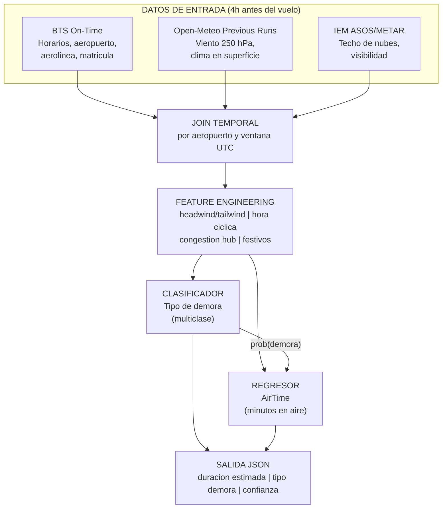
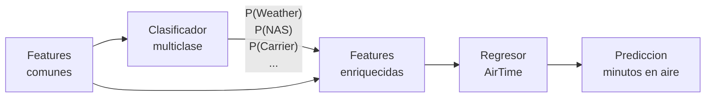
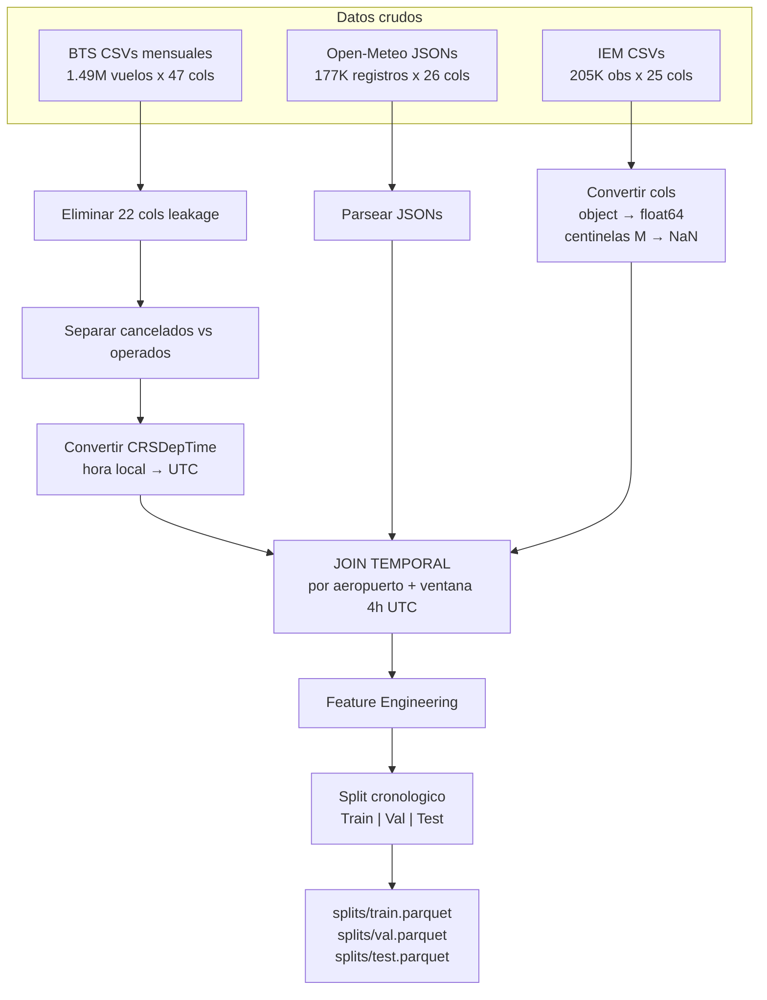
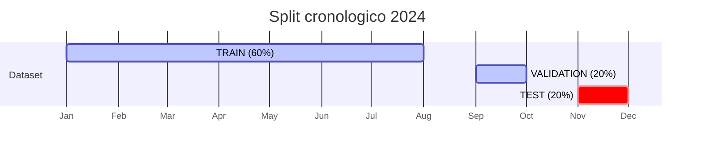
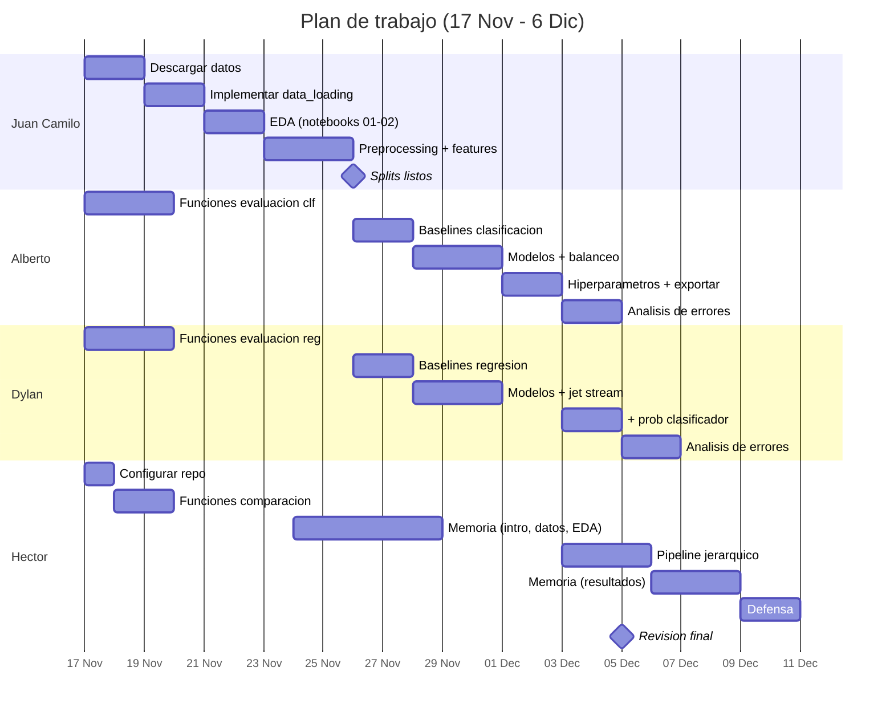

# Anticipando el Caos Aereo mediante Machine Learning

> Sistema predictivo end-to-end que anticipa retrasos y estima la duracion real de vuelos domesticos en EE.UU., orientado a pasajeros que necesitan tomar decisiones horas antes del despegue.

**Universidad de Deusto** | Aprendizaje Automatico 2026-27

---

## Equipo

| Integrante | Rol | Responsabilidad principal |
|---|---|---|
| Juan Camilo Bolanos Aldana | Datos & Feature Engineering | Pipeline de datos, join temporal, ingenieria de caracteristicas |
| Alberto Estrada Guerrero | Clasificacion (1ro) | Modelos de clasificacion de tipo de demora, balanceo de clases |
| Dylan Cantillo Arrieta | Regresion (2do) | Modelos de regresion de AirTime, usa prob. del clasificador como features |
| Hector Emilio Gonzalez Gonzalez | Integracion & Memoria | Flujo jerarquico, memoria, reproducibilidad, defensa |

---

## Arquitectura del sistema



### Flujo jerarquico



El clasificador predice primero la probabilidad de cada tipo de demora. Esas probabilidades se inyectan como features adicionales al regresor de AirTime, afinando la estimacion cuando hay disrupciones meteorologicas o de trafico aereo.

---

## Estructura del repositorio

```
flight-delay-prediction/
|
|-- README.md
|-- requirements.txt
|-- config.py                        # Constantes centralizadas (semillas, splits, leakage)
|-- .gitignore
|
|-- data/
|   |-- raw/                         # Datos originales (NO subir al repo, en .gitignore)
|   |   |-- bts/                     # CSVs mensuales BTS On-Time Performance
|   |   |-- open_meteo/              # Viento 250 hPa por aeropuerto
|   |   |-- iem/                     # Observaciones ASOS/METAR
|   |   +-- download_data.py         # Script para reproducir la descarga
|   |
|   |-- processed/                   # Dataset consolidado tras join y limpieza
|   |   +-- splits/                  # Train/val/test en parquet
|   |
|   +-- data_contract.md             # Fuentes, hashes SHA-256, fechas de descarga
|
|-- notebooks/
|   |-- 01_eda_bts.ipynb
|   |-- 02_eda_weather.ipynb
|   |-- 03_preprocessing.ipynb
|   |-- 04_classification.ipynb
|   |-- 05_regression.ipynb
|   |-- 06_hierarchical_pipeline.ipynb
|   +-- 07_error_analysis.ipynb
|
|-- src/
|   |-- __init__.py
|   |-- data_loading.py              # Stubs con firma + docstring (implementar)
|   |-- preprocessing.py             # Stubs con firma + docstring (implementar)
|   |-- feature_engineering.py       # Stubs con firma + docstring (implementar)
|   |-- evaluation.py                # Stubs con firma + docstring (implementar)
|   +-- utils.py                     # Helpers listos (set_seed, timer, file_sha256)
|
|-- models/
|   |-- classification/              # .joblib del mejor clasificador
|   +-- regression/                  # .joblib del mejor regresor
|
|-- results/
|   |-- figures/                     # Graficos exportados para la memoria
|   |-- tables/                      # CSVs de metricas comparativas
|   +-- experiment_log.md            # Registro de experimentos
|
+-- docs/
    |-- memoria.pdf
    +-- defensa.pdf
```

---

## Que esta listo (base) y que falta (por implementar)

### Ya incluido en la base

| Archivo | Estado | Descripcion |
|---|---|---|
| `config.py` | **Listo** | RANDOM_STATE=42, rutas, fechas de split, 22 columnas de leakage, 8 clases, 20 Core Hubs |
| `requirements.txt` | **Listo** | Todas las dependencias |
| `.gitignore` | **Listo** | Excluye datos, modelos, .venv, IDE |
| `src/utils.py` | **Listo** | `set_seed()`, `timer()`, `df_summary()`, `file_sha256()`, `ensure_dir()` |
| `data/data_contract.md` | **Listo** | Documentacion de las 3 fuentes con placeholders para SHA-256 |
| `data/raw/download_data.py` | **Listo** | Script de descarga (BTS manual + Open-Meteo/IEM automaticos) |
| `results/experiment_log.md` | **Listo** | Plantilla de tracking |
| `notebooks/04_classification.ipynb` | **Listo** | Notebook completo de clasificación — 9 experimentos, balanceo, optimización, exportación de prob. |

### Por implementar (stubs con `raise NotImplementedError`)

| Archivo | Funciones | Responsable |
|---|---|---|
| `src/data_loading.py` | `load_bts()`, `load_open_meteo()`, `load_iem()` | Juan Camilo |
| `src/preprocessing.py` | `convert_crs_to_utc()`, `build_classification_label()`, `separate_cancelled_operated()`, `temporal_join_weather()`, `split_temporal()`, `save_splits()` | Juan Camilo |
| `src/feature_engineering.py` | `compute_bearing()`, `add_flight_bearing()`, `add_headwind_component()`, `add_cyclical_time()`, `add_day_of_week()`, `add_month_cyclical()`, `add_holiday_flag()`, `add_hub_congestion()`, `apply_all_features()` | Juan Camilo |
| `src/evaluation.py` | `classification_metrics()`, `plot_confusion_matrix()`, `plot_per_class_f1()` | ~~Alberto~~ ✅ |
| `src/evaluation.py` | `regression_metrics()`, `plot_predicted_vs_actual()`, `plot_residuals()` | Dylan |
| `src/evaluation.py` | `model_comparison_table()`, `save_comparison_table()` | Hector |

> **Cada funcion tiene su firma, docstring y TODO con instrucciones concretas.** Solo hay que reemplazar el `raise NotImplementedError` por la implementacion real.

---

## Instrucciones detalladas por integrante

### Juan Camilo Bolanos — Datos & Feature Engineering

**Tu objetivo:** Que el equipo tenga `data/processed/splits/train.parquet`, `val.parquet` y `test.parquet` listos para modelar.

**Que hacer paso a paso:**

1. **Descargar datos** (Semana 1, dia 1-2)
   - BTS: descarga manual desde https://www.transtats.bts.gov/ (12 CSVs mensuales 2024, ver instrucciones en `data/raw/download_data.py`)
   - Open-Meteo e IEM: ejecutar `python data/raw/download_data.py --source open_meteo` y `--source iem`
   - Registrar hashes SHA-256 en `data/data_contract.md` usando `src/utils.file_sha256()`

2. **Implementar `src/data_loading.py`** (Semana 1, dia 2-3)
   - `load_bts()`: leer CSVs, eliminar columnas de `config.LEAKAGE_COLUMNS`
   - `load_open_meteo()`: leer CSV, parsear timestamps a UTC
   - `load_iem()`: leer CSV, convertir "M" → NaN, parsear timestamps

3. **Crear `notebooks/01_eda_bts.ipynb`** (Semana 1, dia 3)
   - Distribucion de las 8 clases de retraso (graficos)
   - Verificar el desbalanceo (~76% OnTime)
   - Vuelos por aeropuerto, por aerolinea, por mes
   - Distribucion de AirTime y su correlacion con Distance

4. **Crear `notebooks/02_eda_weather.ipynb`** (Semana 1, dia 3-4)
   - Distribucion del viento a 250 hPa (jet stream)
   - Ceiling y visibility por aeropuerto
   - Verificar cobertura temporal de los datos meteorologicos

5. **Implementar `src/preprocessing.py`** (Semana 1, dia 4-5)
   - `build_classification_label()`: construir las 8 clases **ANTES** de eliminar leakage
   - `convert_crs_to_utc()`: conversion hora local → UTC por timezone del aeropuerto
   - `temporal_join_weather()`: `pd.merge_asof` por aeropuerto + ventana de 4h backward
   - `split_temporal()` y `save_splits()`: split cronologico usando fechas de `config.py`

6. **Implementar `src/feature_engineering.py`** (Semana 1, dia 5-6)
   - Bearing del vuelo + componentes headwind/tailwind del jet stream
   - Features ciclicas (hora, dia de semana, mes)
   - Festivos federales USA 2024 con ventana +/- 1 dia
   - Congestion del hub (vuelos por aeropuerto/dia)

7. **Crear `notebooks/03_preprocessing.ipynb`** (Semana 1, dia 6-7)
   - Pipeline completo: carga → etiquetas → join → features → split → guardar
   - Verificar que no haya leakage
   - Exportar `data/processed/splits/`

**Entregable clave:** Los 3 parquets de train/val/test que Alberto y Dylan necesitan para empezar a modelar.

**Dependencias:** Nadie depende de ti excepto que Alberto y Dylan necesitan los splits para la Semana 2. Deadline: **viernes 21 Nov**.

---

### Alberto Estrada — Clasificacion (1ro en el pipeline jerarquico)

**Tu objetivo:** Encontrar el mejor clasificador multiclase (8 clases de retraso) con Macro F1 >= 0.55 y exportar sus probabilidades para que Dylan las use.

**Que hacer paso a paso:**

1. **Implementar funciones de evaluacion en `src/evaluation.py`** (Semana 1, cuando tengas tiempo)
   - `classification_metrics()`: accuracy, macro_f1, weighted_f1 usando sklearn
   - `plot_confusion_matrix()`: heatmap con seaborn, opcion de normalizar
   - `plot_per_class_f1()`: barras por clase + linea del target 0.55

2. **Crear `notebooks/04_classification.ipynb`** (Semana 2, dia 1-3)
   - Cargar `data/processed/splits/train.parquet` y `val.parquet`
   - Separar X e y (y = `delay_label`)
   - **Baselines:**
     - Clasificador mayoritario (DummyClassifier)
     - LogisticRegression con `class_weight='balanced'`
   - **Modelos a comparar:**
     - RandomForest (n_estimators=100, class_weight='balanced')
     - XGBoost (scale_pos_weight para desbalanceo)
     - LightGBM (is_unbalance=True)
   - **Estrategias de balanceo a probar:**
     - `class_weight='balanced'` (en los que lo soporten)
     - SMOTE (de imbalanced-learn)
     - Undersampling de la clase mayoritaria
   - Registrar cada experimento en `results/experiment_log.md`

3. **Optimizar hiperparametros** (Semana 2, dia 3-5)
   - Usar RandomizedSearchCV con TimeSeriesSplit (o Optuna si da tiempo)
   - **Solo sobre train**, evaluar sobre val
   - Nunca tocar test hasta la evaluacion final

4. **Exportar probabilidades del mejor modelo** (Semana 2, dia 5)
   - `model.predict_proba(X_val)` → guardar como columnas extra
   - Serializar modelo: `joblib.dump(model, 'models/classification/best_clf.joblib')`
   - Avisar a Dylan que las probabilidades estan listas

5. **Analisis de errores** (Semana 3, dia 1-2)
   - Confusion matrix final (normalizada y absoluta)
   - F1 por clase: donde falla mas? (seguramente las clases Cancel_*)
   - Errores por ruta, por aeropuerto, por hora del dia
   - Curvas Precision-Recall por clase
   - Guardar figuras en `results/figures/`

**Entregable clave:** `models/classification/best_clf.joblib` + las probabilidades como features para Dylan.

**Dependencia:** Necesitas los splits de Juan Camilo. Mientras tanto, puedes implementar las funciones de evaluacion y preparar la estructura del notebook.

---

### Dylan Cantillo — Regresion (2do en el pipeline jerarquico)

**Tu objetivo:** Predecir AirTime (minutos en el aire) con MAE <= 15 min, usando las probabilidades del clasificador de Alberto como features adicionales.

**Que hacer paso a paso:**

1. **Implementar funciones de evaluacion en `src/evaluation.py`** (Semana 1, cuando tengas tiempo)
   - `regression_metrics()`: MAE, RMSE, R², MAPE usando sklearn
   - `plot_predicted_vs_actual()`: scatter con linea y=x
   - `plot_residuals()`: histograma + scatter de residuos

2. **Crear `notebooks/05_regression.ipynb`** (Semana 2, dia 1-3)
   - Cargar splits (solo vuelos operados, no cancelados, porque cancelados no tienen AirTime)
   - **Baseline natural:**
     - Regresion lineal Distance → AirTime (r ≈ 0.97)
     - Este es el piso: todo modelo debe superar esta correlacion obvia
   - **Modelos a comparar (SIN probabilidades del clasificador primero):**
     - Ridge/Lasso (baseline regularizado)
     - RandomForest
     - XGBoost
     - LightGBM
   - Registrar cada experimento en `results/experiment_log.md`

3. **Agregar probabilidades del clasificador como features** (Semana 2, dia 4-5)
   - Cuando Alberto te de las probabilidades, agregarlas como 8 columnas extra
   - Comparar MAE con y sin probabilidades
   - **Esta es la hipotesis central del proyecto:** que saber el tipo de demora mejora la prediccion de AirTime

4. **Optimizar hiperparametros** (Semana 2, dia 5)
   - RandomizedSearchCV con TimeSeriesSplit
   - Serializar: `joblib.dump(model, 'models/regression/best_reg.joblib')`

5. **Analisis de errores** (Semana 3, dia 1-2)
   - Predicted vs Actual scatter plot
   - Distribucion de residuos
   - Feature importance (SHAP si da tiempo)
   - Curvas de aprendizaje: hay sobreajuste?
   - Errores por rango de distancia, por aeropuerto, por hora
   - Guardar figuras en `results/figures/`

6. **Probar target alternativo** (Semana 2, opcional)
   - En vez de predecir AirTime directo, predecir el **residuo**: AirTime - CRSElapsedTime
   - Comparar MAE de ambos enfoques

**Entregable clave:** `models/regression/best_reg.joblib` + analisis de si las prob. del clasificador realmente mejoran la prediccion.

**Dependencia:** Necesitas los splits de Juan Camilo + las probabilidades de Alberto. Puedes avanzar sin las probabilidades, y agregarlas cuando esten listas.

---

### Hector Gonzalez — Integracion & Memoria

**Tu objetivo:** Que todo funcione junto (pipeline jerarquico end-to-end), escribir la memoria, y preparar la defensa.

**Que hacer paso a paso:**

1. **Configurar el repositorio** (Semana 1, dia 1)
   - Crear repo en GitHub, subir la base
   - Configurar ramas: `main` (protegida) + ramas `feature/*`
   - Verificar que todos puedan clonar e instalar dependencias

2. **Implementar funciones de comparacion en `src/evaluation.py`** (Semana 1)
   - `model_comparison_table()`: generar tabla comparativa de modelos
   - `save_comparison_table()`: guardar en CSV y Markdown

3. **Crear `notebooks/06_hierarchical_pipeline.ipynb`** (Semana 2, dia 5-7)
   - Cargar mejor clasificador (de Alberto) y mejor regresor (de Dylan)
   - Pipeline completo: datos → clasificador → probabilidades → regresor → prediccion final
   - Evaluar el pipeline end-to-end sobre val y luego sobre **test** (unica vez)
   - Comparar: pipeline jerarquico vs regresor standalone

4. **Crear `notebooks/07_error_analysis.ipynb`** (Semana 3, dia 1-2)
   - Analisis conjunto de errores
   - Donde el clasificador se equivoca, como impacta al regresor?
   - Propuesta de uso: como se integra en una API real

5. **Redactar la memoria** (Semana 2-3)
   - Max 16 paginas de contenido
   - Secciones: Introduccion, Datos, EDA, Metodologia, Resultados, Conclusiones, Limitaciones
   - Incluir figuras de `results/figures/`
   - Guardar en `docs/memoria.pdf`

6. **Preparar la defensa** (Semana 3, dia 4-5)
   - Max 10 diapositivas
   - Narrativa: problema → datos → enfoque jerarquico → resultados → aprendizajes
   - Guardar en `docs/defensa.pdf`

7. **Revision cruzada** (Semana 3, dia 5)
   - Verificar que todo el repo esta limpio
   - Verificar reproducibilidad: `requirements.txt` + `config.py` + splits
   - Verificar que `README.md` esta actualizado

**Entregable clave:** `docs/memoria.pdf` + `docs/defensa.pdf` + pipeline jerarquico validado.

**Dependencia:** Necesitas los modelos de Alberto y Dylan para el pipeline jerarquico. Puedes avanzar con la memoria (intro, datos, EDA) mientras tanto.

---

## Datos

### Fuentes

| Fuente | Tipo | Registros | Descripcion |
|---|---|---|---|
| [BTS On-Time Performance](https://www.transtats.bts.gov/) | Primaria | ~1.498.108 vuelos | Horarios programados/reales, aeropuertos, aerolinea |
| [Open-Meteo Previous Runs API](https://open-meteo.com/) | Secundaria | ~177.600 registros | Vientos a 250 hPa (jet stream) |
| [IEM ASOS/METAR](https://mesonet.agron.iastate.edu/) | Secundaria | ~205.779 obs | Techo de nubes, visibilidad |

### Pipeline de integracion de datos



---

## Tareas predictivas

### Tarea 1: Clasificacion — Tipo de demora (Alberto)

**Pregunta**: *El vuelo sufrira algun tipo de demora especifica?*

| Clase | Descripcion | Proporcion aprox. |
|---|---|---|
| `OnTime` | Sin retraso significativo (< 15 min) | ~76% |
| `Delay_Carrier` | Retraso atribuible a la aerolinea | ~9% |
| `Delay_LateAircraft` | Avion tardio por rotacion | ~8% |
| `Delay_NAS` | Trafico aereo / sistema nacional | ~4% |
| `Delay_Weather` | Condiciones meteorologicas | ~1.5% |
| `Cancel_Carrier` | Cancelacion por aerolinea | <1% |
| `Cancel_Weather` | Cancelacion por clima | <1% |
| `Cancel_NAS` | Cancelacion por sistema aereo | <1% |

**Metricas principales**: Macro F1 >= 0.55 | **Modelos**: LogReg, RandomForest, XGBoost, LightGBM

### Tarea 2: Regresion — Duracion real del vuelo (Dylan)

**Pregunta**: *Cuantos minutos reales tomara el vuelo en el aire?*

**Baseline natural**: Regresion lineal Distance → AirTime (r ≈ 0.97). El valor del ML es capturar variaciones por jet stream (250 hPa, media 57 kt, picos 213 kt), congestion y meteorologia.

**Metricas principales**: MAE <= 15 min | **Modelos**: Ridge/Lasso, RandomForest, XGBoost, LightGBM

---

## Diseno experimental

### Separacion temporal (sin fugas)



> La separacion es estrictamente cronologica. Ningun dato futuro se usa para predecir el pasado.
> El **test set solo se usa UNA vez** al final para la evaluacion definitiva.

---

## Configuracion del entorno

```bash
# Clonar el repositorio
git clone https://github.com/<org>/flight-delay-prediction.git
cd flight-delay-prediction

# Crear entorno virtual
python -m venv .venv
source .venv/bin/activate  # Linux/Mac

# Instalar dependencias
pip install -r requirements.txt
```

---

## Calendario de trabajo



---

## Convenciones del equipo

### Git workflow

- Rama principal: `main` (siempre funcional)
- Ramas de trabajo: `feature/<nombre-descriptivo>` (ej. `feature/join-temporal`)
- Merge a `main` via Pull Request con al menos 1 revision
- Commits descriptivos en espanol

### Prefijos de commit

| Prefijo | Uso |
|---|---|
| `feat:` | Nueva funcionalidad |
| `fix:` | Correccion de bug |
| `data:` | Cambios en datos o pipeline |
| `model:` | Cambios en modelado |
| `docs:` | Documentacion |
| `exp:` | Experimento o prueba |

### Codigo

- Funciones reutilizables en `src/`, no duplicar logica entre notebooks
- Docstrings en todas las funciones publicas
- Imports de constantes desde `config.py`
- Cada `NotImplementedError` en `src/` tiene un TODO con instrucciones

---

## Licencia

Proyecto academico. Datos publicos del BTS, Open-Meteo (CC BY 4.0) e IEM.
