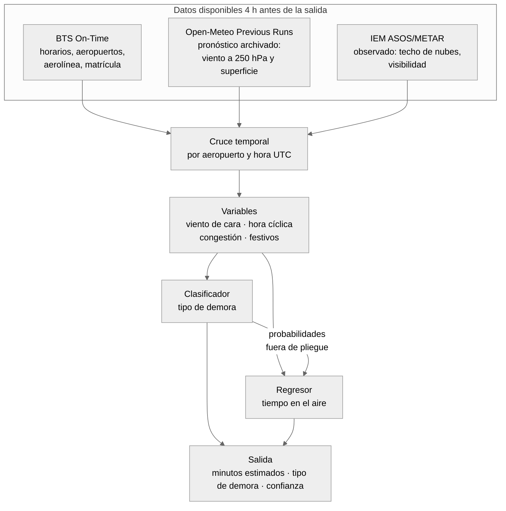
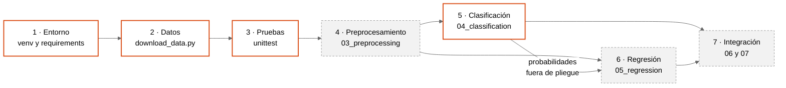
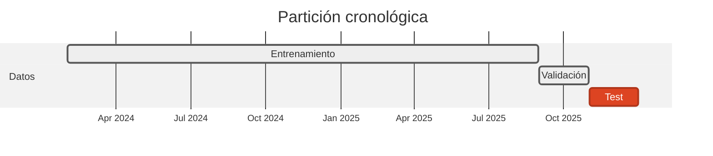

# Anticipando el caos aéreo mediante machine learning

> Sistema predictivo de principio a fin que anticipa el tipo de demora y estima el tiempo real en el aire de vuelos domésticos en EE. UU., para pasajeros que deciden horas antes del despegue.

**Universidad de Deusto** · Aprendizaje Automático 2026-27

| Documento | Para qué sirve |
|---|---|
| `README.md` | Qué es el sistema y cómo se ejecuta |
| [`PLAN.md`](PLAN.md) | Quién hace qué, flujos, estado actual y tabla de acción |
| [`data/data_contract.md`](data/data_contract.md) | Fuentes, periodo, columnas y hashes de los datos crudos |

---

## Equipo

| Integrante | Rol | Responsabilidad principal |
|---|---|---|
| Juan Camilo Bolanos Aldana | Datos y feature engineering | Carga, etiquetas, cruce temporal con el clima, variables y partición |
| Alberto Estrada Guerrero | Clasificación (primero en la cadena) | Tipo de demora, desbalance de clases, probabilidades para el regresor |
| Dylan Cantillo Arrieta | Regresión (segundo en la cadena) | Tiempo en el aire, con y sin las probabilidades del clasificador |
| Hector Emilio Gonzalez Gonzalez | Integración, memoria y apoyo en preprocesamiento | Contrato de datos, clima, calidad y datos compartidos; flujo jerárquico, memoria y defensa |

El reparto tarea por tarea está en [PLAN.md · Quién hace qué](PLAN.md#4-quién-hace-qué) y en la [tabla de acción](PLAN.md#7-tabla-de-acción).

---

## Arquitectura



El clasificador estima la probabilidad de cada tipo de demora. Esas probabilidades entran al regresor como variables adicionales. Para que el regresor no aprenda de probabilidades que ya vieron su propia etiqueta, se generan **fuera de pliegue**: cada fila recibe la probabilidad de un modelo que no la usó para entrenar. El detalle está en [PLAN.md · Flujos](PLAN.md#6-flujos).

---

## Cómo ejecutar

Estado de cada paso a día de hoy, en `main`:

| Símbolo | Significa |
|---|---|
| ● | Funciona y está cerrado |
| ◐ | Funciona, con pendientes anotados en el plan |
| ○ | Todavía no existe |



Todos los comandos se ejecutan desde la raíz del repositorio.

### 1. Entorno ◐

Requiere Python 3.10 o superior.

```bash
git clone https://github.com/albertxestrada/ProyectoAprendizajeSupervisado.git
cd ProyectoAprendizajeSupervisado

python3 -m venv .venv
source .venv/bin/activate          # Windows: .venv\Scripts\activate
pip install -r requirements.txt
```

Pendiente: `requirements.txt` solo fija cotas mínimas, así que dos instalaciones en fechas distintas pueden dar versiones distintas. Fijar versiones exactas y la versión de Python es la tarea [B5](PLAN.md#b5--entorno-fijado).

### 2. Datos ◐

Los datos crudos no van en git: pesan unos 5 GB. Hoy se descargan desde las fuentes; el proceso es lento.

```bash
python data/raw/download_data.py --source all

# o una fuente cada vez
python data/raw/download_data.py --source bts
python data/raw/download_data.py --source open_meteo
python data/raw/download_data.py --source iem
```

Qué deja:

```text
data/raw/bts/on_time_AAAA_MM.csv        un archivo por mes, de feb-2024 a dic-2025
data/raw/open_meteo/wind_250hPa_2024.csv
data/raw/iem/asos_metar_2024.csv
```

Los dos últimos nombres dicen `2024` pero cubren todo el periodo; corregirlo es parte de [B6](PLAN.md#b6--descarga-que-falla-en-voz-alta).

Para comprobar que los archivos son los mismos que usó el equipo, se compara su huella SHA-256 con las tablas de `data/data_contract.md`:

```bash
sha256sum data/raw/bts/*.csv data/raw/open_meteo/*.csv data/raw/iem/*.csv
# macOS: shasum -a 256 ...
```

Si una huella no coincide, la fuente cambió desde la descarga original. Conviene avisar al equipo antes de seguir.

Pendiente ([B8](PLAN.md#b8--datos-compartidos)): publicar los crudos en una Release de GitHub con un manifiesto, para descargarlos y verificarlos de una vez sin volver a las fuentes:

```bash
python data/raw/fetch_data.py      # ○ todavía no existe
```

### 3. Pruebas ◐

```bash
python -m unittest discover -s tests -v
```

Debería encontrar seis pruebas. Tres avisos mientras se cierran [B2](PLAN.md#b2--importar-sin-syspath) y [B7](PLAN.md#b7--pruebas-separadas):

- `python -m unittest` a secas encuentra cero pruebas, porque falta `tests/__init__.py`.
- `test_real_data_loaders` necesita los datos del paso 2; sin ellos falla en lugar de saltarse.
- `test_split_boundaries` comprueba las fechas de 2024; fallará en cuanto `config.py` pase al periodo nuevo.

### 4 a 7. Cuadernos, en orden

| Paso | Cuaderno | Qué hace | Lee | Deja | Responsable | Estado |
|---|---|---|---|---|---|---|
| — | `01_eda_bts` | Exploración de vuelos guiada por preguntas | `data/raw/bts/` | `results/figures/` | Camilo | ○ |
| — | `02_eda_weather` | Exploración del clima y su cobertura | `data/raw/open_meteo/`, `data/raw/iem/` | `results/figures/` | Emilio | ○ |
| 4 | `03_preprocessing` | Carga, etiquetas, horas UTC, cruce con el clima, variables y partición | `data/raw/` | `data/processed/splits/`, `models/preprocessor.joblib` | Camilo, con Emilio | ○ |
| 5 | `04_classification` | Baselines, modelos, calibración y probabilidades fuera de pliegue | `data/processed/splits/` | `models/classification/`, `data/processed/oof_probs.parquet` | Alberto | ◐ en su rama, sin ejecutar |
| 6 | `05_regression` | Tiempo en el aire, primero sin y luego con las probabilidades | `splits/`, `oof_probs.parquet` | `models/regression/` | Dylan | ○ |
| 7 | `06_hierarchical_pipeline` | Cadena completa y evaluación única sobre test | `models/`, `splits/` | `results/tables/` | Dylan y Emilio | ○ |
| 7 | `07_error_analysis` | Errores por grupos: ruta, aeropuerto, hora, clase | todo lo anterior | `results/figures/` | Emilio | ○ |

Para abrirlos, con el entorno activado:

```bash
jupyter notebook notebooks/
```

Para ejecutarlos de principio a fin sin abrirlos, que es como debería poder reproducirlos el profesor:

```bash
for nb in notebooks/0*.ipynb; do
    jupyter nbconvert --to notebook --execute --inplace "$nb"
done
```

Hasta que exista `03_preprocessing`, el preprocesamiento no tiene punto de entrada: las funciones están en `src/`, pero nada las encadena todavía.

### Qué queda fuera de git

```text
data/raw/              crudos; se descargan (paso 2)
data/processed/        partición y probabilidades; se regeneran (pasos 4 y 5)
models/*.joblib        modelos entrenados; irán en la Release (B8)
```

Los patrones de `.gitignore` tienen errores que hoy dejan pasar archivos; arreglarlos es [B1](PLAN.md#b1--gitignore-correcto).

---

## Estructura del repositorio

Hoy, en `main`:

```text
ProyectoAprendizajeSupervisado/
├── README.md                 este archivo
├── PLAN.md                   plan de acción
├── config.py                 rutas, semilla, fechas, clases, aeropuertos
├── requirements.txt
├── data/
│   ├── data_contract.md      fuentes y hashes
│   ├── raw/
│   │   ├── download_data.py  descarga desde las fuentes
│   │   ├── bts/  iem/  open_meteo/
│   └── processed/
│       └── splits/
├── notebooks/                vacío en main; el 04 está en la rama de Alberto
├── src/
│   ├── data_loading.py       carga de las tres fuentes
│   ├── preprocessing.py      UTC, etiquetas, cruce con clima, partición
│   ├── feature_engineering.py
│   ├── evaluation.py         plantillas por implementar
│   └── utils.py              semilla, temporizador, sha256
├── models/
│   ├── classification/
│   └── regression/
├── results/
│   ├── experiment_log.md
│   ├── figures/
│   └── tables/
├── tests/
│   └── test_data_feature_engineering.py
└── docs/                     memoria y defensa, al final
```

La estructura objetivo, con cada archivo nuevo marcado con su tarea y su responsable, está en [PLAN.md · Estructura de carpetas](PLAN.md#8-estructura-de-carpetas).

---

## Datos

| Fuente | Tipo | Qué aporta |
|---|---|---|
| [BTS On-Time Performance](https://www.transtats.bts.gov/) | Primaria | Horarios programados y reales, aeropuertos, aerolínea, causas de demora |
| [Open-Meteo Previous Runs](https://open-meteo.com/) | Secundaria | Pronóstico archivado tal como se conocía antes del vuelo; viento a 250 hPa |
| [IEM ASOS/METAR](https://mesonet.agron.iastate.edu/) | Secundaria | Observaciones en el aeropuerto: techo de nubes, visibilidad |

- **Periodo:** febrero de 2024 a diciembre de 2025.
- **Aeropuertos:** hoy, los 20 hubs de `config.CORE_HUBS`. Si se amplía a todos es una [decisión abierta](PLAN.md#10-decisiones-abiertas).
- **Recuento de filas:** pendiente de rehacer con el periodo ampliado ([P1](PLAN.md#p1--contrato-de-datos-y-trazabilidad)).

El flujo completo de preprocesamiento, paso a paso, está en [PLAN.md · Flujos](PLAN.md#6-flujos).

---

## Tareas predictivas

### Clasificación: tipo de demora

*¿El vuelo sufrirá algún tipo de demora, y de cuál?*

| Clase | Descripción |
|---|---|
| `OnTime` | Sin retraso significativo (menos de 15 min) |
| `Delay_Carrier` | Retraso atribuible a la aerolínea |
| `Delay_LateAircraft` | Avión tardío por rotación |
| `Delay_NAS` | Tráfico aéreo o sistema nacional |
| `Delay_Weather` | Condiciones meteorológicas |
| `Cancel_Carrier` | Cancelación por la aerolínea |
| `Cancel_Weather` | Cancelación por clima |
| `Cancel_NAS` | Cancelación por el sistema aéreo |

`OnTime` domina con holgura y las cancelaciones son muy raras; las proporciones se recalculan con el periodo nuevo. Quedarse con 8 clases o agrupar en 6 está abierto en el plan.

- **Objetivo en `config.py`:** Macro F1 de al menos 0,55.
- **Modelos:** regresión logística, random forest, XGBoost, LightGBM.

### Regresión: tiempo en el aire

*¿Cuántos minutos pasará el avión en el aire?*

El piso es una regresión lineal de distancia a tiempo en el aire, con correlación cercana a 0,97. El valor del modelo está en lo que la distancia no explica: viento en altura, congestión y meteorología. Elegir entre tiempo en el aire y retraso de llegada como variable objetivo está abierto en el plan.

- **Objetivo en `config.py`:** error absoluto medio de 15 min como máximo.
- **Modelos:** Ridge y Lasso, random forest, XGBoost, LightGBM.

---

## Diseño experimental

### Partición temporal



- La partición es estrictamente cronológica: ningún dato futuro predice el pasado.
- El test se usa **una sola vez**, al final, en `06_hierarchical_pipeline`.
- `config.py` todavía tiene las fechas de 2024; actualizarlas es [P12](PLAN.md#p12--partición-temporal-con-separación).

---

## Convenciones del equipo

### Git

- `main` siempre funciona; el trabajo va en ramas `feature/<descripción>`.
- Se fusiona a `main` por pull request con al menos una revisión.
- El orden de fusión de las ramas abiertas está en [PLAN.md · Flujos](PLAN.md#6-flujos).
- Commits descriptivos en español, con prefijo:

| Prefijo | Uso |
|---|---|
| `feat:` | Nueva funcionalidad |
| `fix:` | Corrección de un error |
| `data:` | Cambios en datos o en el preprocesamiento |
| `model:` | Cambios en modelado |
| `docs:` | Documentación |
| `exp:` | Experimento o prueba |

### Código

- La lógica reutilizable vive en `src/`; los cuadernos la llaman, no la copian.
- Las constantes se importan de `config.py`, nunca se escriben a mano en un cuaderno.
- Docstrings en todas las funciones públicas.
- Los cuadernos se suben ejecutados de principio a fin, con sus salidas.
- Cada experimento deja una fila en `results/experiment_log.md`.

---

## Licencia

Proyecto académico. Datos públicos del BTS, Open-Meteo (CC BY 4.0) e IEM.
