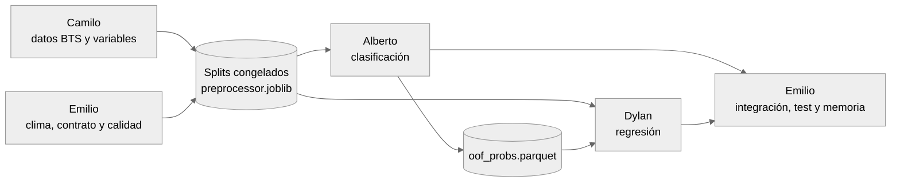
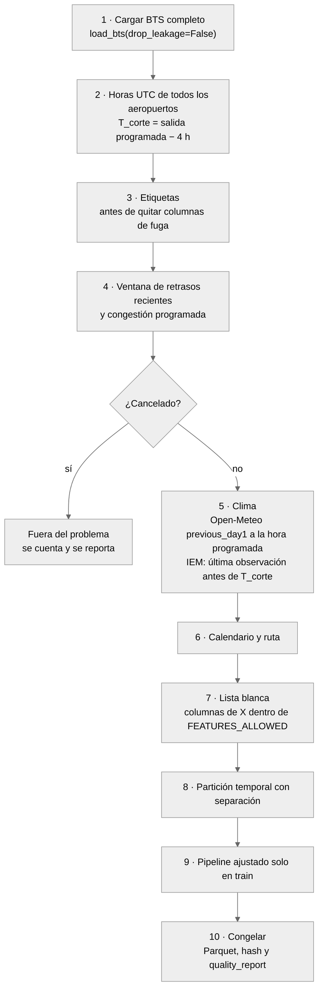
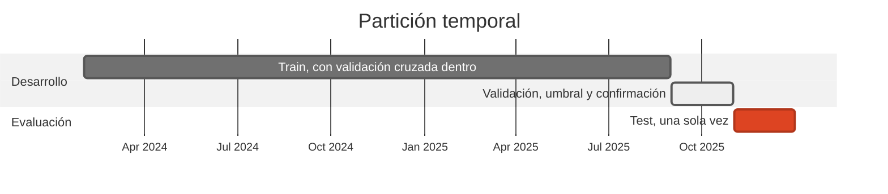
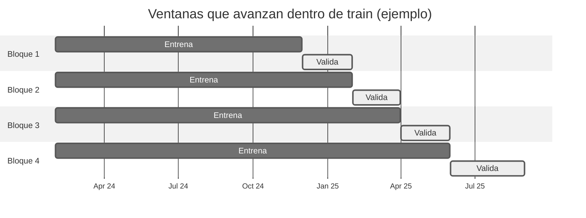
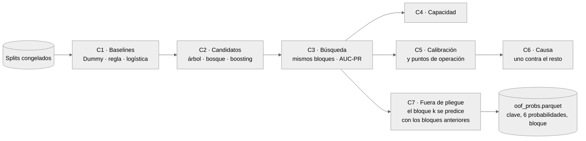
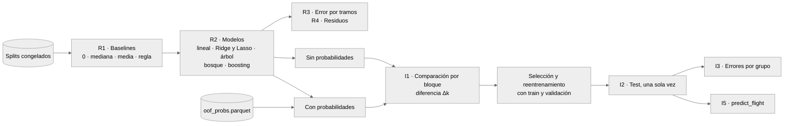
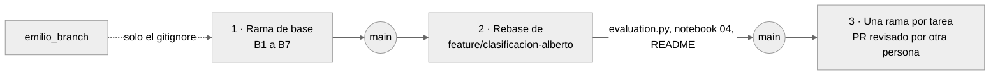

# Plan de acción · Anticipando el caos aéreo

Proyecto de Aprendizaje automático (520291, MUCSI Deusto). Versión visual.

Este plan concreta el README y el documento «Reunión de equipo». Muestra qué hay que hacer, quién lo hace y en qué orden. Cada tarea dice qué hacer, por qué, cuándo está terminada y qué archivo deja. El reparto de personas es una propuesta que sigue los roles del README; el equipo la ajusta.

> **Hasta dónde va cada tarea está en [ESTADO.md](ESTADO.md).** Este plan cambia poco; el estado cambia en cada PR. Por eso viven separados.

---

## Índice

1. [Cómo leer este plan](#1-cómo-leer-este-plan)
2. [Cinco principios](#2-cinco-principios)
3. [Mapa del sistema](#3-mapa-del-sistema)
4. [Quién hace qué](#4-quién-hace-qué)
5. [Estado del repositorio](#5-estado-del-repositorio)
6. [Flujos](#6-flujos)
7. [Tabla de acción](#7-tabla-de-acción)
8. [Estructura de carpetas](#8-estructura-de-carpetas)
9. [Fase 0 · Formulación](#9-fase-0--formulación)
10. [Decisiones abiertas](#10-decisiones-abiertas)
11. [Detalle de tareas](#11-detalle-de-tareas)
12. [Prioridades si falta tiempo](#12-prioridades-si-falta-tiempo)
13. [Mapa de la rúbrica](#13-mapa-de-la-rúbrica)
14. [Fuera del temario](#14-fuera-del-temario)
15. [Riesgos principales](#15-riesgos-principales)

---

## 1. Cómo leer este plan

**Estados.** Viven solo en [ESTADO.md](ESTADO.md), junto con su leyenda y los hallazgos abiertos. El plan no los repite.

**Fuentes**

| Marca | Significado |
|---|---|
| **[S04]** | Sesión de clase que respalda la tarea (S01–S14, o el Playbook del tema 1). |
| **[D Regresión]** | Decisión razonada en el proyecto personal de aviación (`decisiones.md`), por el título de su entrada. |
| **[Enunciado]** | Requisito del enunciado oficial del proyecto. |
| **[Reunión §n]** | Punto del documento de la reunión de equipo. |
| **[Revisión]** | Hallazgo de la revisión técnica del repositorio. |
| **Fuera del temario** | Técnica que no aparece en el material de clase. Se puede usar, pero hay que justificarla en la memoria y saber defenderla. Si hay una alternativa vista en clase, se prefiere esa. |
| **A confirmar** | Decisión que el equipo cierra. El plan da la opción recomendada y qué cambia con la otra. |

**Nombres.** Camilo es Juan Camilo Bolaños; Alberto, Alberto Estrada; Dylan, Dylan Cantillo; Emilio, Héctor Emilio González.

---

## 2. Cinco principios

Todo el plan sale de estas cinco reglas. Si una tarea las rompe, la tarea está mal.

1. **Nada posterior al corte.** El corte (T_corte) es cuatro horas antes de la salida programada. Toda variable debe existir antes de ese momento [Playbook §1.2], [D T_corte].
2. **Lista blanca, no lista negra.** Entra en el modelo solo lo que está en la lista de variables permitidas. Una lista negra falla en silencio cuando aparece una columna nueva [S03].
3. **Lo que se aprende de los datos se ajusta solo con train.** Imputación, escalado, codificación y umbrales de niveles raros van dentro de un `Pipeline` [S03], [S06].
4. **El regresor recibe probabilidades fuera de pliegue.** Nunca las de un clasificador que ya vio esas filas [S11].
5. **El test se usa una sola vez.** Al final, con los modelos ya elegidos [S07].

---

## 3. Mapa del sistema

Cada caja es un paso del sistema, con la tarea que lo cubre.

```mermaid
%%{init: {'theme':'neutral'}}%%
flowchart LR
    subgraph FUENTES["Fuentes"]
        BTS["BTS On-Time<br>feb-2024 a dic-2025"]
        OM["Open-Meteo<br>pronóstico archivado"]
        IEM["IEM ASOS/METAR<br>clima observado"]
    end

    subgraph PRE["Preprocesamiento · Camilo y Emilio"]
        DL["Descarga y hashes<br>download_data.py · P1"]
        UTC["Horas UTC y T_corte<br>P4"]
        LAB["Etiquetas<br>P5"]
        WIN["Ventana de retrasos<br>recientes · P6"]
        CONG["Congestión<br>programada · P7"]
        CAN["Quitar cancelados"]
        WX["Cruce de clima<br>P8 · P9"]
        FE["Calendario y ruta<br>P10"]
        WL["Lista blanca<br>P2"]
        SPL["Partición temporal<br>P12"]
        PIPE["Pipeline ajustado<br>en train · P13"]
        FRZ["Datos congelados<br>P14"]
    end

    subgraph CLS["Clasificación · Alberto"]
        CM["Baselines y modelos<br>C1 a C6"]
        OOF["Probabilidades<br>fuera de pliegue · C7"]
    end

    subgraph REG["Regresión · Dylan"]
        RM["Baselines y modelos<br>R1 a R4"]
    end

    subgraph INT["Integración · Emilio"]
        I1["Con y sin<br>probabilidades · I1"]
        TST["Test único<br>I2"]
        USE["predict_flight<br>I5"]
    end

    BTS & OM & IEM --> DL
    DL --> UTC --> LAB --> WIN --> CONG --> CAN --> WX --> FE --> WL --> SPL --> PIPE --> FRZ
    FRZ --> CM --> OOF --> I1
    FRZ --> RM --> I1
    I1 --> TST --> USE
```



El orden importa en tres sitios, y por eso el flujo es una sola línea:

- La **etiqueta** va antes de quitar columnas de fuga, porque necesita `ArrDelay` y los minutos por causa.
- La **ventana de retrasos** y la **congestión** van antes de quitar cancelados, porque el horario programado incluye a los cancelados.
- Todo lo que **aprende de los datos** va después de la partición.

---

## 4. Quién hace qué

### 4.1 Entregas entre personas

Cada flecha es un archivo que una persona le entrega a otra. Nadie empieza su fase con datos que no estén congelados.



### 4.2 Reparto por persona

Propuesta construida sobre los roles del README. Emilio apoya el preprocesamiento por el lado del clima y la calidad, y después lleva la integración y la memoria.

| Persona | Rol | Tareas | Deja | Recibe de | Entrega a |
|---|---|---|---|---|---|
| **Camilo** | Datos BTS y variables | B3, B4, B6 · P2–P7, P10, P11 (BTS), P12, P13 | `01_eda_bts`, `03_preprocessing`, `src/preprocessing.py`, `src/feature_engineering.py` | Fuentes | Alberto, Dylan |
| **Emilio** | Apoyo en preprocesamiento: clima, contrato y calidad | B1, B8, B9 (su rama) · P1, P8, P9, P11 (clima), P14 | `02_eda_weather`, `data/data_contract.md`, `data/manifest.csv`, `results/quality_report.md` | Fuentes | Alberto, Dylan |
| **Emilio** | Integración y memoria | I2, I3, I5, I6, I7 · E1, E3 | `06_hierarchical_pipeline` (montaje), `07_error_analysis`, memoria, ZIP | Alberto, Dylan | Profesor |
| **Alberto** | Clasificación | B2, B9 (su rama) · C1–C7 · I4 (clasificación) | `04_classification`, funciones de clasificación de `src/evaluation.py`, `oof_probs.parquet` | Camilo, Emilio | Dylan, Emilio |
| **Dylan** | Regresión | B5, B7 · R1–R4 · I1 · I4 (regresión) | `05_regression`, `06_hierarchical_pipeline` (comparación con y sin), funciones de regresión de `src/evaluation.py` | Camilo, Emilio, Alberto | Emilio |
| **Todos** | Defensa | E2 | `docs/defensa.pdf` | — | Profesor |

**Por qué B2, B5 y B7 van a Alberto y Dylan.** Mientras los datos se congelan, la clasificación y la regresión esperan. Ese tiempo se usa en la base del repositorio, y así Camilo y Emilio no cargan con todo lo previo.

---

## 5. Estado del repositorio

Qué está hecho y qué falta en cada tarea, y los hallazgos abiertos de la revisión, están en [ESTADO.md](ESTADO.md). Se actualiza en el mismo PR que avanza la tarea.

---

## 6. Flujos

### 6.1 Preprocesamiento

Los números son el orden de ejecución dentro de `03_preprocessing`. El rombo es el único punto donde se pierden filas a propósito.



Cada paso que borre filas deja una línea en el registro de decisiones con cuántas y por qué. Hoy el cruce de clima borra filas sin hora y nadie se entera [Revisión].

### 6.2 Partición temporal

Periodo cerrado por el equipo: febrero de 2024 a diciembre de 2025.



Dentro de train, la validación cruzada usa ventanas que avanzan [S04]. Cada bloque entrena con todo lo anterior y valida con lo siguiente. Los bloques de abajo son un ejemplo: el equipo los fija en P12.



- Entre conjuntos queda al menos un día de separación [S04 «Separación según disponibilidad»].
- El primer bloque valida en invierno, y el test también cae en invierno: así la búsqueda no solo ve verano.
- Coste para C7: el periodo de entrenamiento inicial (feb–nov 2024) no recibe probabilidades fuera de pliegue. Un bloque inicial más corto pierde menos filas, pero entrena peor al primer clasificador.

### 6.3 Clasificación y probabilidades fuera de pliegue



De dónde sale cada probabilidad que recibe el regresor:

| Conjunto | Clasificador que predice | Por qué |
|---|---|---|
| Train, bloque k | Entrenado con los bloques anteriores a k | Ningún vuelo se predice con un modelo que lo vio, ni con uno que vio su futuro. |
| Validación | Entrenado con todo train | Validación queda fuera del ajuste. |
| Test | Reentrenado con train y validación | Es el modelo que se usaría en producción. |

### 6.4 Regresión e integración



La comparación con y sin probabilidades es lo que **nunca se recorta** (§12).

### 6.5 Ramas y orden de fusión



- La rama de Emilio choca con `main`. De ella se toma el `.gitignore`; el resto ya está en `main` o se rehace.
- La rama de Alberto nació antes que `main`. Al hacer *rebase* se quedan solo sus archivos: `src/evaluation.py`, el notebook 04 y su parte del README. Los cambios en el resto de `src/` son versiones viejas y se descartan.
- Prefijos de commit del README: `feat`, `fix`, `data`, `model`, `docs`, `exp`.

---

## 7. Tabla de acción

Cada fila enlaza con su detalle en la §11. Hasta dónde va cada tarea está en [ESTADO.md](ESTADO.md).

### Base del repositorio

| ID | Tarea | Responsable | Apoyo | Deja |
|---|---|---|---|---|
| [B1](#b1--gitignore-correcto) | `.gitignore` correcto y fuera los `.DS_Store` | Emilio | — | `.gitignore` |
| [B2](#b2--importar-sin-syspath) | Importar sin `sys.path` y descubrir las pruebas | Alberto | Camilo | `tests/__init__.py` |
| [B3](#b3--una-sola-fuente-de-aeropuertos) | Una sola fuente de aeropuertos | Camilo | — | `data/reference/airports.csv` |
| [B4](#b4--constantes-en-configpy) | Constantes en `config.py` | Camilo | — | `config.py` |
| [B5](#b5--entorno-fijado) | Entorno fijado | Dylan | — | `pyproject.toml`, `uv.lock`, `requirements.txt`, `.python-version` |
| [B6](#b6--descarga-que-falla-en-voz-alta) | Descarga que falla en voz alta | Camilo | Emilio | `data/raw/download_data.py` |
| [B7](#b7--pruebas-separadas) | Pruebas separadas por tipo | Dylan | Camilo | `tests/` |
| [B8](#b8--datos-compartidos) | Datos compartidos y verificables | Emilio | Camilo | `data/manifest.csv`, `data/raw/fetch_data.py` |
| [B9](#b9--fusionar-ramas) | Fusionar ramas pendientes | Alberto · Emilio | Dylan | `main` limpio |

### Preprocesamiento

| ID | Tarea | Responsable | Apoyo | Deja |
|---|---|---|---|---|
| [P1](#p1--contrato-de-datos-y-trazabilidad) | Contrato de datos y trazabilidad | Emilio | Camilo | `data/data_contract.md` |
| [P2](#p2--lista-blanca-de-variables) | Lista blanca de variables | Camilo | Alberto, Dylan | `config.py`, `tests/test_leakage.py` |
| [P3](#p3--arreglos-de-carga-y-transformación) | Arreglos de carga y transformación | Camilo | — | `src/` |
| [P4](#p4--horas-en-utc-para-todos-los-aeropuertos) | Horas UTC de todos los aeropuertos | Camilo | — | `src/preprocessing.py` |
| [P5](#p5--etiquetas) | Etiquetas | Camilo | Alberto | `src/preprocessing.py` |
| [P6](#p6--ventana-de-retrasos-recientes) | Ventana de retrasos recientes | Camilo | Dylan | `feature_engineering.recent_delays()` |
| [P7](#p7--congestión-programada) | Congestión programada | Camilo | — | `feature_engineering.py` |
| [P8](#p8--clima-pronóstico-archivado-open-meteo) | Clima: pronóstico archivado | Emilio | Camilo | `download_data.py`, `feature_engineering.py` |
| [P9](#p9--clima-observado-iem-asosmetar) | Clima observado | Emilio | Camilo | `download_data.py`, `preprocessing.py` |
| [P10](#p10--variables-de-calendario-y-ruta) | Calendario y ruta | Camilo | — | `feature_engineering.py` |
| [P11](#p11--eda-guiado-por-preguntas) | EDA guiado por preguntas | Camilo (BTS) · Emilio (clima) | — | `01_eda_bts`, `02_eda_weather` |
| [P12](#p12--partición-temporal-con-separación) | Partición temporal | Camilo | Alberto, Dylan | `config.py`, `preprocessing.py` |
| [P13](#p13--transformaciones-dentro-de-un-pipeline) | Transformaciones en un `Pipeline` | Camilo | Alberto, Dylan | `preprocessing.build_pipeline()`, `models/preprocessor.joblib` |
| [P14](#p14--calidad-y-congelación-de-datos) | Calidad y congelación | Emilio | Camilo | `data/processed/splits/`, `results/quality_report.md` |

### Clasificación

| ID | Tarea | Responsable | Apoyo | Deja |
|---|---|---|---|---|
| [C1](#c1--baselines) | Baselines | Alberto | — | `04_classification`, `src/evaluation.py` |
| [C2](#c2--modelos-candidatos) | Modelos candidatos | Alberto | — | `04_classification` |
| [C3](#c3--optimización-de-hiperparámetros) | Búsqueda de hiperparámetros | Alberto | — | `04_classification` |
| [C4](#c4--diagnóstico-de-capacidad) | Diagnóstico de capacidad | Alberto | — | `04_classification` |
| [C5](#c5--calibración-y-umbral) | Calibración y umbral | Alberto | Dylan | `04_classification` |
| [C6](#c6--evaluación-de-la-causa) | Evaluación de la causa | Alberto | — | `04_classification` |
| [C7](#c7--probabilidades-fuera-de-pliegue-para-el-regresor) | Probabilidades fuera de pliegue | Alberto | Dylan | `oof_probs.parquet`, `evaluation.oof_predict()` |

### Regresión

| ID | Tarea | Responsable | Apoyo | Deja |
|---|---|---|---|---|
| [R1](#r1--baselines) | Baselines | Dylan | — | `05_regression` |
| [R2](#r2--modelos) | Modelos | Dylan | — | `05_regression` |
| [R3](#r3--métricas-y-cola-larga) | Métricas y cola larga | Dylan | — | `05_regression`, `src/evaluation.py` |
| [R4](#r4--residuos-y-capacidad) | Residuos y capacidad | Dylan | — | `05_regression` |

### Integración

| ID | Tarea | Responsable | Apoyo | Deja |
|---|---|---|---|---|
| [I1](#i1--regresor-con-y-sin-probabilidades) | Regresor con y sin probabilidades | Dylan | Emilio | `06_hierarchical_pipeline` |
| [I2](#i2--selección-final-y-test-único) | Selección final y test único | Emilio | Alberto, Dylan | `06_hierarchical_pipeline`, `results/experiment_log.md` |
| [I3](#i3--análisis-de-errores-por-grupos) | Errores por grupos | Emilio | Alberto, Dylan | `07_error_analysis` |
| [I4](#i4--interpretación) | Interpretación | Alberto · Dylan | Emilio | `04`, `05` |
| [I5](#i5--propuesta-de-uso) | Propuesta de uso | Emilio | Dylan | `predict_flight()` |
| [I6](#i6--ciclo-de-vida) | Ciclo de vida | Emilio | Camilo | Memoria |
| [I7](#i7--reproducibilidad) | Reproducibilidad | Emilio | Todos | `README.md` |

### Entrega

| ID | Tarea | Responsable | Apoyo | Deja |
|---|---|---|---|---|
| [E1](#e1--memoria) | Memoria | Emilio | Todos, cada uno su sección | `docs/memoria.pdf` |
| [E2](#e2--defensa) | Defensa | Todos | — | `docs/defensa.pdf` |
| [E3](#e3--zip) | ZIP | Emilio | — | Entrega |

---

## 8. Estructura de carpetas

### 8.1 Hoy

La estructura actual está en el [README](../README.md#estructura-del-repositorio). No se repite aquí para que no se desfase.

### 8.2 Objetivo

Cada pieza nueva va marcada con su tarea y su responsable.

```text
ProyectoAprendizajeSupervisado/
├── .gitattributes                     plan y estado fuera del ZIP (E3 · Emilio)
├── .gitignore                         B1 · Emilio
├── .python-version                    B5 · Dylan
├── README.md                          punto de entrada: cómo ejecutar
├── config.py                          única fuente de fechas, horizonte y lista blanca
├── pyproject.toml                     dependencias (B5); paquete instalable (B2)
├── requirements.txt                   para pip; se genera desde uv.lock (B5)
├── uv.lock                            versiones exactas (B5)
├── data/
│   ├── data_contract.md               P1 · Emilio
│   ├── manifest.csv                   B8 · sha256, URL y fecha de cada crudo
│   ├── reference/
│   │   └── airports.csv               B3 · IATA, ICAO, zona horaria, lat, lon, tamaño FAA
│   ├── raw/                           fuera de git
│   │   ├── download_data.py           descarga desde las fuentes (lento)
│   │   ├── fetch_data.py              B8 · baja la Release y verifica hashes (rápido)
│   │   ├── bts/  iem/  open_meteo/
│   └── processed/                     fuera de git
│       ├── splits/                    P14 · train, val y test en Parquet
│       └── oof_probs.parquet          C7 · Alberto
├── notebooks/
│   ├── 01_eda_bts.ipynb               P11 · Camilo
│   ├── 02_eda_weather.ipynb           P11 · Emilio
│   ├── 03_preprocessing.ipynb         P1–P14 · Camilo
│   ├── 04_classification.ipynb        C1–C7 · Alberto
│   ├── 05_regression.ipynb            R1–R4 · Dylan
│   ├── 06_hierarchical_pipeline.ipynb I1–I2 · Dylan y Emilio
│   └── 07_error_analysis.ipynb        I3 · Emilio
├── src/
│   ├── __init__.py
│   ├── data_loading.py
│   ├── evaluation.py                  C1 y R3 · Alberto y Dylan
│   ├── feature_engineering.py
│   ├── preprocessing.py
│   └── utils.py
├── models/                            pesados fuera de git; van en la Release
│   ├── preprocessor.joblib            P13
│   ├── classification/
│   └── regression/
├── results/
│   ├── experiment_log.md              una fila por experimento
│   ├── decision_log.csv               una fila por decisión de datos
│   ├── quality_report.md              P14 · Emilio
│   ├── figures/
│   └── tables/
├── tests/
│   ├── __init__.py                    B2
│   ├── test_preprocessing.py          B7 · unitarias, sin datos reales
│   ├── test_leakage.py                P2 · lista blanca y T_corte
│   └── test_real_data.py              B7 · se salta si faltan los datos
└── docs/
    ├── ESTADO.md                      estado de cada tarea; no entra en el ZIP
    ├── PLAN.md                        coordinación; no entra en el ZIP
    ├── memoria.pdf                    E1
    └── defensa.pdf                    E2
```

---

## 9. Fase 0 · Formulación

Es la ficha de definición del dataset del Playbook §1.1. Va al inicio de la memoria y del README.

| Elemento | Valor | Fuente |
|---|---|---|
| Decisión que apoya | El pasajero decide, antes de ir al aeropuerto, si mueve su recogida, su conexión o su agenda. | [D T_corte] |
| Usuario | Pasajero de un vuelo nacional de EE. UU. sin escala. | [D Población] |
| Momento de corte (T_corte) | **T−4 h** sobre la salida programada, provisional: 2 h para llegar al aeropuerto y 2 h para enterarse y actuar. | [D T_corte] |
| Unidad de observación | Un vuelo sin escala programado. | [D Clave] |
| Clave | `Reporting_Airline`, `Flight_Number_Reporting_Airline`, `FlightDate`, `OriginAirportID`. | [D Clave] |
| Tarea de clasificación | Si el vuelo llegará con retraso (`ArrDelay` ≥ 15) y, si es así, por qué causa. | [Enunciado], [D Coste de cada error] |
| Tarea de regresión | Cuántos minutos de retraso tendrá a la llegada (`ArrDelay`, con signo). **A confirmar.** | [D Regresión] |
| Conexión entre tareas | Las probabilidades del clasificador entran como variables del regresor. Se mide si aportan. | [Enunciado], [S11] |
| Información prohibida | Todo lo que ocurre después de T_corte: tiempos reales de salida y llegada, `AirTime`, `TaxiOut`, `WheelsOff`, minutos por causa, cancelación y matrícula real (`Tail_Number`). | [Playbook §1.2], [D T_corte], [D Ventana] |
| Vuelos cancelados | Fuera del entrenamiento y de la evaluación: es otro problema. Se quitan **después** de calcular la ventana de retrasos recientes. En producción, si el vuelo ya figura cancelado, no se predice. | [D Cancelados] |

**Por qué la clasificación no es una discretización trivial** [Enunciado]. El umbral de 15 minutos es la definición oficial de BTS (`ArrDel15`), y es el que usa el DOT para la puntualidad. La causa responde otra pregunta: no cuánto, sino por qué. Esa respuesta le dice al pasajero qué compensación puede reclamar. El enunciado pide justificar esta distinción, y conviene escribirla así.

**Criterios de éxito, ligados a la decisión** (se escriben antes de medir) [S04 «Qué debe acompañar al resultado»]:

- Clasificación: superar en AUC-PR al clasificador de prevalencia (Dummy), de forma estable en todos los bloques de validación.
- Regresión: superar en MAE a la mediana del entrenamiento y a la regla «llega a su hora» (predicción 0).
- Integración: el regresor con probabilidades mejora al regresor sin ellas en la mayoría de los bloques, no solo en promedio.
- Equidad: los aeropuertos pequeños (FAA *small hub* y *nonhub*) no rinden peor que el resto en la misma métrica [D Grupos].

**Hecho cuando:** la ficha está en `README.md` y en `data/data_contract.md`. Cada fila tiene su fuente.

---

## 10. Decisiones abiertas

Cada bloque trae la recomendación y lo que cambia si el equipo se queda con la versión actual. El resto del plan está escrito para la recomendación.

### 10.1 Población y periodo

- **Periodo: cerrado.** Febrero de 2024 a diciembre de 2025 (`config.py`). Empieza después del 25-ene-2024, así que el pronóstico archivado de Open-Meteo está completo en todo el periodo [D Población].
- **Población: abierta.**
  - **Recomendado:** vuelos nacionales sin escala de todos los aeropuertos. La descarga de BTS ya los trae todos. Con solo 20 *hubs* no existen los aeropuertos pequeños, y no se puede medir si se les perjudica [D Grupos].
  - Coste: más volumen y más zonas horarias (P4), y clima para más estaciones (P8, P9). Si la memoria RAM no alcanza, se muestrea de forma estratificada por mes y por tamaño de aeropuerto.
  - **Versión actual, de hecho:** 20 *hubs*, porque el resto de vuelos se pierde al no tener zona horaria. Si el equipo se queda aquí, el filtro tiene que ser explícito y contado, no un efecto secundario. El análisis de equidad se hace entre *hubs* grandes y medianos, y se declara como limitación.

### 10.2 Objetivo de regresión

- **Recomendado:** `ArrDelay` en minutos, con signo [D Regresión].
  - Responde a la pregunta del pasajero: a qué hora llega.
  - `AirTime` se explica casi entero por la distancia (r ≈ 0,97), y las causas dominantes del retraso, aerolínea y avión anterior, ocurren en tierra.
  - `ArrDelayMinutes` se descarta: convierte los adelantos en cero y le oculta información al pasajero.
  - Riesgos: cola larga, y una meta de MAE ≤ 15 que puede no alcanzarse. El cambio respecto a la entrega intermedia se explica en la memoria.
- **Versión actual:** `AirTime` (`REGRESSION_TARGET` en `config.py`).
  - Qué cambia: el baseline lineal `Distance → AirTime` ya será muy bueno, y el aporte de las probabilidades será pequeño. Si se mantiene, conviene usar el residuo `AirTime − CRSElapsedTime` como objetivo, que el README ya deja como opción.

### 10.3 Clases

- **Recomendado:** seis clases: sin retraso, aerolínea (*carrier*), clima (*weather*), sistema aéreo (*NAS*), seguridad (*security*) y avión anterior (*late aircraft*).
  - Las clases `Cancel_*` desaparecen porque los cancelados salen del problema [D Cancelados].
  - Seguridad es diminuta. Hay dos salidas: fusionarla con aerolínea (fusión de niveles raros, [S03]) o mantenerla y reportar que no se aprende. Se decide al ver su frecuencia en el EDA.
- **Versión actual:** ocho clases, con `Cancel_*` (`CLASSIFICATION_LABELS`).
  - Qué cambia: se usa la cancelación como etiqueta, pero `Cancelled` es fuga como variable. Habría que justificar por qué la cancelación se puede predecir a T−4 h. No hay fuente sobre qué parte de las cancelaciones se decide antes de ese momento [D Cancelados].

### 10.4 Métrica de clasificación

- **Recomendado** [D Coste de cada error], [S04]:
  - La curva PR y el AUC-PR eligen el modelo y el umbral.
  - La curva ROC compara grupos y periodos, porque no cambia con la prevalencia.
  - El log-loss y el diagrama de fiabilidad comprueban la calibración.
  - Se descartan como criterio F1, *accuracy* y *accuracy* balanceada: exigen un umbral fijo. Pueden aparecer en la matriz de confusión del umbral elegido, solo como descripción.
- **Versión actual:** F1 macro ≥ 0,55 (`TARGET_MACRO_F1`).
  - Qué cambia: hay que fijar el umbral antes de comparar modelos, y justificar ese umbral con un coste de error que el sistema no conoce.

---

## 11. Detalle de tareas

**Principio** [Playbook]: cada paso sigue el ciclo expectativa → diagnóstico → tratamiento, y deja una fila en el registro de decisiones (`results/decision_log.csv`). Lo determinista va antes de la partición. Todo lo que se aprende de los datos se ajusta solo con train.

### Fase B · Base del repositorio

Son arreglos de ingeniería: no cambian el modelo, pero sin ellos nadie más puede reproducir nada [Revisión], [Enunciado].

#### B1 · `.gitignore` correcto

- **Responsable:** Emilio.
- **Qué:**
  - Tomar el `.gitignore` de `emilio_branch` como base.
  - `__pycache__/` en lugar de `_pycache_/`.
  - `models/**/*.joblib` (y `.pkl`) en lugar de `models/*/.joblib`, que solo ignora un archivo llamado literalmente `.joblib`.
  - `*.parquet` y `data/raw/**` ignorados; excepciones para `data/manifest.csv` y `data/reference/*.csv`, porque hoy `*.csv` los ignoraría.
  - Sacar del índice los tres `.DS_Store` (`git rm --cached`).
- **Hecho cuando:** `git status` queda limpio después de correr la descarga, las pruebas y un notebook.

#### B2 · Importar sin `sys.path`

- **Responsable:** Alberto, con Camilo.
- **Qué:**
  - Quitar `sys.path.append` de los cinco módulos de `src/`, de `data/raw/download_data.py` y del notebook 04.
  - Sobre el `pyproject.toml` que ya existe (B5), no uno nuevo: quitar `package = false`, añadir un `[build-system]` y declarar el paquete `src` y el módulo `config`. Así `from src…` e `import config` funcionan desde la raíz, desde `tests/` y desde los notebooks.
  - Después, `uv lock` y regenerar `requirements.txt` con el comando del README. Con uv, `uv sync` instala el proyecto en modo editable; con pip, `pip install -e .`.
  - Ejecutar desde la raíz no basta para los notebooks: el kernel arranca en `notebooks/` aunque Jupyter se lance desde la raíz.
  - Crear `tests/__init__.py`. Sin él, `python -m unittest` desde la raíz no encuentra ninguna prueba (comprobado con Python 3.12).
- **Hecho cuando:** `python -m unittest` desde la raíz corre las pruebas, y el notebook 04 importa de `src` sin tocar `sys.path`.

#### B3 · Una sola fuente de aeropuertos

- **Responsable:** Camilo.
- **Qué:** un único `data/reference/airports.csv` con IATA, ICAO, zona horaria, latitud, longitud y tamaño FAA. Lo leen `config.py`, la descarga, `preprocessing.py` y `feature_engineering.py`. Hoy hay cuatro copias: `CORE_HUBS`, `HUB_COORDS` (dos veces), `AIRPORT_TIMEZONES` e `IATA_TO_ICAO`.
- **Por qué:** cuatro copias acaban diciendo cosas distintas. Además, P4 necesita las zonas de todos los aeropuertos, no de 20.
- **Hecho cuando:** buscar `HUB_COORDS` o `AIRPORT_TIMEZONES` en el código no devuelve definiciones, solo lecturas del CSV.

#### B4 · Constantes en `config.py`

- **Responsable:** Camilo.
- **Qué:** mover a `config.py` el horizonte de 4 h (`PREDICTION_HORIZON_H`), la tolerancia del cruce de clima, la ventana de retrasos recientes y las fechas de partición de P12.
- **Hecho cuando:** cambiar el corte de 4 a 3 horas se hace en una sola línea.

#### B5 · Entorno fijado

- **Responsable:** Dylan.
- **Qué:**
  - `pyproject.toml` es la única lista de dependencias y el único archivo que se edita a mano. Sus límites superiores se comprobaron ejecutando las pruebas y los notebooks.
  - `uv.lock` guarda las versiones exactas para uv. `requirements.txt` lleva las mismas para pip y se genera desde `uv.lock` con el comando del README; no se edita a mano.
  - Python 3.12 en `.python-version` y en el README.
- **Por qué:** con `>=`, el profesor puede instalar una versión de scikit-learn que cambia resultados o argumentos [Enunciado, reproducibilidad].
- **Hecho cuando:** un entorno nuevo, instalado con uv o con pip, corre las pruebas y el notebook 03.

#### B6 · Descarga que falla en voz alta

- **Responsable:** Camilo, con Emilio.
- **Qué:**
  - Quitar los `except Exception` que imprimen y siguen. Reintentar lo recuperable y, si falla, terminar con código distinto de cero.
  - Al final, un resumen: archivos esperados, descargados y fallidos.
  - Nombres de archivo con el periodo real (`wind_250hPa_2024-02_2025-12.csv`), no `_2024`.
- **Hecho cuando:** cortar la red a mitad de descarga hace que el script termine con error y diga qué falta.

#### B7 · Pruebas separadas

- **Responsable:** Dylan, con Camilo.
- **Qué:**
  - Separar las pruebas unitarias, con datos construidos a mano, de la prueba con datos reales.
  - La de datos reales se salta (`unittest.skipUnless`) si no están los archivos.
  - La de partición se reescribe con las fechas de P12, leídas de `config.py`.
  - La de viento comprueba el signo con un caso conocido: rumbo 0°, viento del norte a 10 nudos, viento de cara +10.
- **Hecho cuando:** en un clon sin datos, `python -m unittest` pasa y avisa de la prueba saltada.

#### B8 · Datos compartidos

- **Responsable:** Emilio, con Camilo.
- **Qué:**
  - Subir los crudos (o un Parquet reducido a las columnas de la lista blanca más las de etiqueta) como *assets* de una Release de GitHub. Si superan el límite por archivo, dividir por mes.
  - `data/manifest.csv`: archivo, tamaño, sha256, URL de origen y fecha de extracción.
  - `data/raw/fetch_data.py`: baja de la Release, verifica cada sha256 y falla si alguno no coincide.
- **Por qué:** los datos ocupan unos 5 GB y no caben en git, pero el profesor debe poder reproducir sin volver a las API [Enunciado].
- **Hecho cuando:** en una carpeta limpia, `fetch_data.py` deja los datos verificados sin tocar las fuentes originales.

#### B9 · Fusionar ramas

- **Responsables:** Alberto (su rama) y Emilio (la suya), con Dylan de revisor.
- **Qué:** el orden de la §6.5. Primero la rama de base; después el *rebase* de `feature/clasificacion-alberto`, con solo sus archivos; de `emilio_branch`, solo el `.gitignore`.
- **Hecho cuando:** no quedan ramas con trabajo sin fusionar, y `main` pasa las pruebas.

### Fase 1 · Preprocesamiento

#### P1 · Contrato de datos y trazabilidad

- **Responsable:** Emilio, con Camilo.
- **Qué:**
  - Completar `data/data_contract.md` con los seis bloques del Playbook §1.6: identidad, propósito, esquema, calidad, servicio y evolución.
  - Por cada fuente, registrar origen, responsable, frecuencia, zona horaria, términos de uso y momento de extracción. Para las API, también *endpoint*, parámetros y hora de la llamada [Playbook §1.3].
  - Corregir «reanálisis» por **«pronóstico archivado»** en Open-Meteo: *Previous Runs* guarda lo que se pronosticó, no lo que ocurrió.
  - Corregir «`skyc1` (techo)»: el techo sale de `skyl1` (P9).
  - Recontar los vuelos: «~1,49 M» no cuadra con todos los aeropuertos en 23 meses.
- **Por qué:** la rúbrica evalúa trazabilidad y prevención de fugas (9 %), y el profesor debe poder acceder a los datos [Enunciado].
- **Hecho cuando:** cada archivo crudo tiene SHA-256, URL y fecha en `data/manifest.csv`, y hay una copia compartible (B8).

#### P2 · Lista blanca de variables

- **Responsable:** Camilo, con Alberto y Dylan.
- **Qué:** sustituir `LEAKAGE_COLUMNS` por una lista blanca `FEATURES_ALLOWED` en `config.py`. Cada variable lleva su momento de disponibilidad respecto a T_corte (árbol del Playbook §1.2: si t ≤ T_corte, entra en X).
- **Por qué:** una lista negra falla en silencio cuando aparece una columna nueva. Hoy deja pasar `AirTime`, `Cancelled`, `CancellationCode` y `Tail_Number` [Reunión §2]. Es la ruta de fuga temporal de [S03].
- **Hecho cuando:** `tests/test_leakage.py` comprueba que las columnas de X son un subconjunto de la lista blanca, y falla si entra otra.

#### P3 · Arreglos de carga y transformación

- **Responsable:** Camilo. Los siete primeros arreglos salen de la [Reunión §1]; los dos últimos, de la [Revisión].

| Arreglo | Dónde |
|---|---|
| `load_bts` permite construir la etiqueta antes de quitar columnas de fuga (`drop_leakage=False`). | `data_loading.py` |
| `load_open_meteo` usa los nombres de columna nuevos. | `data_loading.py` |
| `load_iem`: errata `airpot_iata` y «M» en todas las columnas. | `data_loading.py` |
| `convert_crs_to_utc`: tipo correcto y hora 2400 al día siguiente. | `preprocessing.py` |
| `build_classification_label` sin `TypeError`. | `preprocessing.py` |
| `split_temporal` con `>=`. | `preprocessing.py` |
| `compute_bearing` con la fórmula correcta. | `feature_engineering.py` |
| `load_bts(months=…)` filtra el mes sin el año. | `data_loading.py` |
| `prediction_time_utc` duplica una hora que ya existe. | `preprocessing.py` |

- **Hecho cuando:** cada función tiene una prueba mínima con un caso conocido, y el notebook 03 corre de principio a fin.

#### P4 · Horas en UTC para todos los aeropuertos

- **Responsable:** Camilo.
- **Qué:**
  - Conservar la hora local y la UTC con el patrón `campo_raw` / `campo_utc` [Playbook].
  - Obtener la zona horaria de cada aeropuerto de la población desde `airports.csv` (B3), no solo de 20.
  - Calcular `T_corte_utc = CRSDep_utc − 4 h`, con el horizonte leído de `config.py`.
  - Contar y registrar las filas sin zona, en vez de dejarlas en `NaT`.
- **Por qué:** todos los cruces con clima y con la ventana de retrasos dependen de esta hora. Hoy, un vuelo de un aeropuerto sin zona queda en `NaT` y el cruce de clima lo borra sin avisar.
- **Hecho cuando:** ningún aeropuerto de la población queda sin zona, y una muestra de 20 vuelos revisada a mano coincide.

#### P5 · Etiquetas

- **Responsable:** Camilo, con Alberto.
- **Qué:**
  - Binaria: `retraso = ArrDelay >= 15`, igual que `ArrDel15` de BTS.
  - Causa: la de más minutos entre las cinco columnas de causa, solo si `retraso = 1`. Escribir una regla de desempate fija.
  - Seguridad (`SecurityDelay`) hoy no se mira: incluirla.
  - Vuelo con retraso pero sin minutos de causa: hoy va a aerolínea. Pasarlo a cuarentena y contar cuántos son [Playbook §1.5].
  - Código D y vuelos desviados: hoy van a «sin retraso». Con los cancelados fuera, el código D debería desaparecer: comprobarlo. Los desviados no llegan a su destino: decidir si salen como los cancelados.
  - Regresión: `ArrDelay` (o la rama de `AirTime`, §10.2).
- **Hecho cuando:** la suma por clase cuadra con el total de vuelos no cancelados, y la tabla de frecuencias va a la memoria.

#### P6 · Ventana de retrasos recientes

- **Responsable:** Camilo, con Dylan.
- **Qué:**
  - Para cada vuelo, el retraso de los vuelos de su aerolínea que llegan a su aeropuerto de origen en las 2 h anteriores a T_corte.
  - La ventana termina en el corte, nunca centrada.
  - Los vuelos que debían llegar en la ventana y no han llegado cuentan con el retraso acumulado hasta el corte: `T_corte − llegada programada`. Nunca con su hora real de llegada.
  - Los cancelados entran en la ventana como vuelos que no han llegado.
  - Se calcula **antes** de quitar los cancelados.
  - Resúmenes: mediana, proporción con retraso ≥ 15 y número de vuelos. La mediana porque es robusta ante la cola [Playbook §2].
- **Por qué:** sustituye al vuelo anterior del mismo avión, que exigiría `Tail_Number`. La matrícula de BTS es la del avión que voló, no la asignada en el corte [D Ventana]. Contar solo los que aterrizaron dejaría fuera a los que van tarde: sesgo de supervivencia.
- **Hecho cuando:** una prueba con un vuelo construido a mano confirma que ningún dato posterior al corte entra en la ventana.
- **Fuera del temario:** la idea viene de Rebollo y Balakrishnan (ICRAT 2012), que usan una ventana centrada. Aquí se adapta para que no haya fuga. Citarlo en la memoria.

#### P7 · Congestión programada

- **Responsable:** Camilo.
- **Qué:** número de salidas y llegadas programadas en el aeropuerto **en la hora** del vuelo. Hoy `add_hub_congestion` cuenta salidas por día. Se cuenta con **todos** los vuelos programados, cancelados incluidos, antes de filtrar.
- **Por qué:** el horario programado se conoce de antemano. Contar después de quitar cancelados usa la cancelación, que es fuga [Reunión §2].
- **Hecho cuando:** el conteo se hace sobre el dataset sin filtrar, y lo comprueba una aserción.

#### P8 · Clima: pronóstico archivado (Open-Meteo)

- **Responsable:** Emilio, con Camilo.
- **Qué:**
  - Descargar `_previous_day1`: el pronóstico emitido el día anterior. Hoy se pide `day0`, que es fuga [Reunión §2].
  - Cruzar en origen a la hora de salida programada y en destino a la hora de llegada programada. Hoy se cruza solo en origen, a la hora del corte.
  - Comprobar si existen los 250 hPa con `previous_day1`. Si no, quitarlos, o pedir corridas concretas con la API *Single Runs* (`&run=`).
  - Corregir el signo del viento de cara: con la convención meteorológica (dirección desde donde sopla), es `+V·cos(dir − rumbo)`.
- **Por qué:** a T−4 h, el pasajero solo tiene pronósticos emitidos antes del corte.
- **Hecho cuando:** el contrato dice qué corrida se usa y su antelación respecto a T_corte, y la prueba de B7 fija el signo.

#### P9 · Clima observado (IEM ASOS/METAR)

- **Responsable:** Emilio, con Camilo.
- **Qué:**
  - Última observación anterior a T_corte en origen., con `merge_asof` hacia atrás y tolerancia de 4 h.
  - En destino, también la última anterior a T_corte: no la de la hora de llegada. Hoy no se cruza.
  - «M» pasa a ausente, con un indicador `_was_missing` [S03]. La conversión ya está; falta el indicador.
  - Descargar `skyl1` además de `skyc1`. El techo de nubes es la altura de la primera capa BKN u OVC. `skyc1` solo, como ordinal CLR < FEW < SCT < BKN < OVC.
  - Antigüedad de la observación en minutos, como variable.
- **Por qué:** una observación posterior al corte es fuga temporal [S03, cuatro rutas de fuga]. `skyc1` es ordinal, no nominal [S03].
- **Hecho cuando:** ninguna observación usada tiene marca de tiempo posterior a T_corte (aserción).

#### P10 · Variables de calendario y ruta

- **Responsable:** Camilo.
- **Qué:**
  - Hora programada codificada de forma cíclica con seno y coseno; día de la semana; mes; festivo [S03].
  - Distancia y rumbo.
  - Aerolínea, origen y destino como nominales. Los niveles raros se agrupan en «otros», con el umbral aprendido en train [S03].
  - Tamaño FAA del aeropuerto de origen, para equidad y también como variable.
- **Por qué:** los códigos enteros (`OriginAirportID`) son nominales aunque se guarden como números [Playbook §2].
- **Fuera del temario, opcional:** codificación por objetivo (*target encoding*) para origen y destino. Clase la ve [S03], pero exige hacerla fuera de pliegue: «la fila participa en su propio valor».

#### P11 · EDA guiado por preguntas

- **Responsables:** Camilo (`01_eda_bts`) y Emilio (`02_eda_weather`). [S02, Playbook §2]
- **Qué:**
  - Perfilado mínimo: forma, tipos, `nunique`, ausentes por columna, fila, fuente y **tiempo**, y cuantiles.
  - Prevalencia de retraso por mes. Se predijo entre el 20 % y el 30 % [D Coste de cada error]: escribir el resultado junto a la predicción.
  - Frecuencia de cada causa: decide si seguridad se fusiona (§10.3).
  - Cobertura por tamaño de aeropuerto, y cobertura del clima por estación y mes.
  - Distribución de `ArrDelay`: cola, adelantos y atípicos. Se diagnostican, no se recortan sin razón.
  - Correlaciones solo entre numéricas. Correlacionar con la clase codificada como número no tiene sentido.
- **Hecho cuando:** cada gráfico responde una pregunta escrita encima, y cada hallazgo deja una fila en el registro.

#### P12 · Partición temporal con separación

- **Responsable:** Camilo, con Alberto y Dylan. [S04, S07]
- **Qué:**

| Conjunto | Periodo | Uso |
|---|---|---|
| Desarrollo · train | 1-feb-2024 → 31-ago-2025 | Ajuste. Validación cruzada temporal dentro. |
| Desarrollo · validación | 1-sep-2025 → 31-oct-2025 | Umbral, calibración y comparación final entre candidatos. |
| Test | 1-nov-2025 → 31-dic-2025 | Una sola vez, al final. Simula el periodo de uso más reciente [S04]. |

- Actualizar `TRAIN_END`, `VAL_START`, `VAL_END` y `TEST_START` en `config.py`. Hoy siguen en 2024: train de feb a ago de 2024, y test de nov-2024 a dic-2025.
- La validación cruzada dentro de train usa ventanas que avanzan por bloques de meses [S04 «Ventanas que avanzan»]. Ejemplo en la §6.2. El test queda fuera de todas las iteraciones.
- **Separación entre conjuntos** [S04 «Separación según disponibilidad»]: al menos un día entre bloques, para que ninguna ventana de retrasos recientes cruce de un conjunto a otro.
  - El hueco real de operación es mayor: BTS publica cada mes con retraso (a comprobar cuánto). Se discute en ciclo de vida (I6).
- **Por qué no `TimeSeriesSplit` a secas:** es solo el nombre de una clase de scikit-learn. Lo que clase enseña es la idea: ventanas que avanzan con separación. Se puede usar esa clase si se le pasa `gap`, pero lo que hay que defender es el diseño.
- **Hecho cuando:** una tabla de la memoria muestra fechas, filas y prevalencia de cada bloque, y la prueba de partición (B7) usa estas fechas.

#### P13 · Transformaciones dentro de un `Pipeline`

- **Responsable:** Camilo, con Alberto y Dylan.
- **Qué:** imputación, escalado y codificación dentro de un `ColumnTransformer` + `Pipeline` de scikit-learn, ajustado solo con train y aplicado a validación y test.
- **Por qué:** es la ruta de fuga por transformación [S03]. En la validación cruzada, los escaladores se recalculan dentro de cada entrenamiento [S06 «Separación experimental»].
- **Hecho cuando:** el `Pipeline` serializado se carga en el notebook 06 sin reajustarse.

#### P14 · Calidad y congelación de datos

- **Responsable:** Emilio, con Camilo.
- **Qué:**
  - Tabla de calidad (*scorecard*) con reglas CRITICAL y WARNING, y decisión por lote: ACEPTAR, NOTIFICAR o CUARENTENA [Playbook §1.5].
  - Informe de calidad con las ocho dimensiones del Playbook §1.4. Representatividad y cobertura son las que más importan aquí.
  - Congelar: guardar train, validación y test en Parquet con su *hash* y fecha. Desde ese momento nadie toca los datos sin una fila nueva en el registro.
- **Hecho cuando:** existen `data/processed/splits/*.parquet`, `results/quality_report.md` y un manifiesto de ejecución con *hashes* [Playbook].

### Fase 2 · Clasificación

**Diseño:** un clasificador multiclase de seis clases. De él sale la probabilidad binaria que necesita el pasajero: `P(retraso) = 1 − P(sin retraso)`. El umbral y la equidad se evalúan sobre esa binaria. La causa se evalúa por clase, uno contra el resto.

#### C1 · Baselines

- **Responsable:** Alberto. [S05]
- **Qué:**
  - `DummyClassifier(strategy="prior")`: el AUC-PR de referencia es la prevalencia [S04].
  - Regla simple: «se retrasa si la ventana de retrasos recientes tiene mediana ≥ 15». Es la referencia de regla sencilla que pide [S04].
  - Regresión logística multinomial con variables escaladas y `class_weight="balanced"`. Sin `multi_class=…`: ese argumento está obsoleto desde scikit-learn 1.5.
  - Llevar a `main` las funciones de clasificación de `src/evaluation.py` que ya están en su rama.
- **Hecho cuando:** los tres tienen AUC-PR, log-loss y ROC en validación cruzada y en validación.

#### C2 · Modelos candidatos

- **Responsable:** Alberto. [S08–S11]

| Modelo | Sesión | Hiperparámetros a explorar |
|---|---|---|
| KNN (opcional) | S08 | K, distancia, escalado. Probabilidades poco calibradas: comprobarlas. |
| Naive Bayes (opcional) | S08 | Suavizado. Sirve de referencia rápida. |
| Árbol de decisión | S09 | Profundidad, hojas mínimas, Gini o entropía, poda. |
| Random Forest | S10 | `n_estimators`, `max_features`, profundidad, tamaño de hoja. Error OOB. |
| Gradient Boosting / LightGBM | S11 | Tasa de aprendizaje, número de árboles con parada temprana [S06], hojas, `subsample` con `subsample_freq > 0`. |

- **Desbalance:** pesos de clase. En LightGBM multiclase, `is_unbalance` no hace nada: usar `class_weight="balanced"` [Reunión §3].
- **No usar SMOTE ni submuestreo como opción principal.** Están fuera del temario y distorsionan las probabilidades que recibe el regresor y que lee el pasajero. Si se prueban, es solo como comparación, y recalibrando después.
- **Hecho cuando:** cada candidato tiene su fila en el registro de experimentos con métrica, desviación entre bloques y tiempo de entrenamiento.

#### C3 · Optimización de hiperparámetros

- **Responsable:** Alberto. [S07]
- **Qué:**
  - Búsqueda aleatoria o *successive halving*, con escala logarítmica para tasas y regularización.
  - Cada configuración pasa por los mismos bloques temporales de P12, con las transformaciones aprendidas dentro de cada bloque.
  - Criterio: AUC-PR de la binaria. Desempate: log-loss.
  - Comparar los dos mejores candidatos bloque a bloque (diferencia Δk por bloque) [S07]. No elegir por un promedio que esconde un bloque malo.
- **Por qué:** «buscar también puede sobreajustar a la validación» [S07]. La validación de sep–oct no se usa para buscar, solo para confirmar.
- **Hecho cuando:** se reporta magnitud, estabilidad y coste de cada configuración final [S07].

#### C4 · Diagnóstico de capacidad

- **Responsable:** Alberto. [S06]
- **Qué:** brecha entre train y validación por modelo; curva de aprendizaje con fracciones crecientes de train para el mejor modelo.
- **Por qué:** dice si conviene más datos (población completa) o más capacidad [S06 «Más datos pueden revelar qué limita el aprendizaje»].
- **Hecho cuando:** hay una figura y una frase de interpretación en la memoria.

#### C5 · Calibración y umbral

- **Responsable:** Alberto, con Dylan. [S04]
- **Qué:**
  - Diagrama de fiabilidad, Brier y log-loss de la binaria en validación.
  - Si está mal calibrada, recalibrar con un subconjunto de desarrollo que el modelo no vio. La técnica concreta (isotónica o Platt) está **fuera del temario**: justificarla, o reportar la descalibración como limitación.
  - Umbral: el sistema entrega la probabilidad, y el pasajero elige [D Coste de cada error]. Para la memoria y la demo, mostrar tres puntos de operación sobre la curva PR. Por ejemplo, precisión de 0,5, 0,6 y 0,7, con su recall.
  - Comprobar que la proporción de vuelos predichos con retraso queda cerca de la prevalencia real (20–30 %).
- **Hecho cuando:** la figura PR con los tres puntos y la de fiabilidad están en `04_classification`.

#### C6 · Evaluación de la causa

- **Responsable:** Alberto.
- **Qué:** AUC-PR uno contra el resto por causa, y su media macro; matriz de confusión entre causas, solo en vuelos retrasados.
- **Por qué:** la media macro no deja que las clases grandes tapen a las pequeñas [S04 micro/macro/ponderada].
- **Hecho cuando:** hay una tabla por clase con soporte. Las clases que no se aprenden se dicen claramente.

#### C7 · Probabilidades fuera de pliegue para el regresor

- **Responsable:** Alberto, con Dylan. [S11 Stacking]
- **Qué:**
  - Dividir train en los bloques temporales de P12.
  - Para cada bloque k, entrenar el clasificador final con los bloques anteriores y predecir el bloque k.
  - El periodo inicial no tiene probabilidades y queda fuera del entrenamiento del regresor: es el coste (§6.2).
  - Validación: la predice el clasificador entrenado con todo train.
  - Test: lo predice el clasificador reentrenado con todo desarrollo (train + validación).
  - Unir por la clave del vuelo, nunca por posición.
- **Por qué:** es lo que clase llama «entrenar K versiones de cada base» para construir la matriz Z del *stacking* [S11]. Si el regresor aprende con `predict_proba(X_train)`, recibe probabilidades demasiado seguras, y en test se encuentra otras [Reunión §2]. Hoy el notebook 04 exporta `predict_proba` sobre validación, que tiene el mismo problema si el regresor se entrena ahí. Aquí solo se usan bloques anteriores: así ningún bloque se predice con un modelo que vio el futuro.
- **Hecho cuando:** `data/processed/oof_probs.parquet` tiene la clave, seis probabilidades por vuelo y el bloque que las generó. Una aserción comprueba que ningún vuelo se predijo con un modelo que lo vio.

### Fase 3 · Regresión

Escrita para `ArrDelay`. La rama de `AirTime` se indica en cada tarea.

#### R1 · Baselines

- **Responsable:** Dylan. [S05]
- **Qué:**
  - Constante 0: «llega a su hora».
  - Mediana de train: el óptimo para el error absoluto.
  - Media de train: el óptimo para el error cuadrático.
  - Regla simple: la mediana de la ventana de retrasos recientes.
  - Rama `AirTime`: regresión lineal `Distance → AirTime`.
- **Hecho cuando:** los cuatro tienen MAE, RMSE y R² por bloque.

#### R2 · Modelos

- **Responsable:** Dylan. [S05, S06, S09–S11]

| Modelo | Sesión | Nota |
|---|---|---|
| Regresión lineal | S05 | One-hot con categoría de referencia; revisar colinealidad. |
| Ridge, Lasso, Elastic Net | S06 | Con escalado. Lasso informa qué variables sobran. |
| Árbol de regresión | S09 | Profundidad y hojas mínimas. |
| Random Forest | S10 | Robusto ante atípicos en las variables. |
| Gradient Boosting / LightGBM | S11 | Parada temprana con validación interna [S06]. |
| SVR (opcional) | S09 | Probablemente caro con este volumen: descartar si no escala. |

- **Hecho cuando:** cada uno pasa por la misma búsqueda y los mismos bloques que en C3.

#### R3 · Métricas y cola larga

- **Responsable:** Dylan.
- **Qué:**
  - Métrica principal: **MAE**, en minutos e interpretable por el pasajero. Secundarias: RMSE, que castiga la cola, y R².
  - MAPE no se usa: `ArrDelay` vale 0 o es negativo en muchos vuelos [S04, cuidado con MAPE].
  - MAE por tramos de retraso real: adelantado, de 0 a 15, de 15 a 60, de 60 a 180 y más de 180. Ahí se ve dónde falla.
  - Variante opcional de [S03] (log1p para colas largas): como `ArrDelay` tiene negativos, usar `signo(y)·log1p(|y|)`, y volver a minutos para medir. Justificarla, porque no es la forma vista en clase.
  - La meta de MAE ≤ 15 del README pasa a ser relativa: mejora sobre la mediana de train. Antes de medir, escribir qué mejora se espera, igual que se hizo con la prevalencia [D Coste de cada error].
  - Implementar las funciones de regresión de `src/evaluation.py`, hoy vacías.
- **Por qué:** optimizar un número sin la pregunta detrás lleva a modelos que mejoran la métrica y no el uso.
- **Hecho cuando:** la tabla de tramos está en `05_regression`.

#### R4 · Residuos y capacidad

- **Responsable:** Dylan. [S05, S06]
- **Qué:** residuos frente a predicción, frente a hora del día y frente a tamaño de aeropuerto; brecha entre train y validación; curva de aprendizaje.
- **Hecho cuando:** cada patrón visible tiene una frase de interpretación.

### Fase 4 · Integración

#### I1 · Regresor con y sin probabilidades

- **Responsable:** Dylan, con Emilio.
- **Qué:**
  - El mismo modelo y la misma búsqueda, con dos conjuntos de variables: sin probabilidades y con las seis probabilidades fuera de pliegue de C7.
  - Comparación pareada por bloque (Δk) [S07]: cuántos bloques mejora, la mejora media y su dispersión.
  - Una tercera variante, opcional: solo `P(retraso)` en lugar de las seis. Aclara si aporta la causa o solo el retraso.
- **Por qué:** es la conexión entre tareas que pide el enunciado, y es lo que **nunca se recorta**.
- **Hecho cuando:** hay una tabla con Δk por bloque y una conclusión que se puede defender aunque la mejora sea nula.

#### I2 · Selección final y test único

- **Responsable:** Emilio, con Alberto y Dylan. [S07]
- **Qué:**
  1. Elegir clasificador y regresor con validación cruzada y confirmar en validación.
  2. Reentrenar ambos con todo desarrollo (train + validación).
  3. Generar las probabilidades del test con el clasificador reentrenado.
  4. Evaluar el test **una sola vez** y anotar fecha y *hash* del modelo.
- **Por qué:** es la ruta válida de [S07]. Si el test se usa para decidir, deja de medir generalización.
- **Hecho cuando:** el resultado de test está en el registro con la versión del código y de los datos.

#### I3 · Análisis de errores por grupos

- **Responsable:** Emilio, con Alberto y Dylan.
- **Qué:**
  - Por tamaño de aeropuerto (FAA), mes y estación, aerolínea y hora del día.
  - Clasificación: ROC por grupo y periodo; recall al umbral de demo por grupo [D Coste de cada error], [D Grupos].
  - Regresión: MAE por grupo.
  - Un grupo sale perjudicado si su métrica es peor que la del resto en la misma métrica. La diferencia aceptable no está fijada: decirlo como limitación.
  - Revisar los diez peores errores del test a mano y clasificarlos (clima extremo, dato ausente, avión anterior, etc.).
- **Hecho cuando:** la tabla y el análisis de casos están en `07_error_analysis`.

#### I4 · Interpretación

- **Responsables:** Alberto (clasificación) y Dylan (regresión), con Emilio.
- **Qué:** coeficientes de la logística y de Ridge [S05]; importancia por impureza en el bosque [S10], con su límite: «la importancia no explica causalidad» y favorece variables con muchos cortes.
- **Fuera del temario:** SHAP no aparece en el material de clase. Si se usa, justificarlo y saber explicarlo en la defensa. Si no, basta con lo de clase.

#### I5 · Propuesta de uso

- **Responsable:** Emilio, con Dylan.
- **Qué:**
  - Una función `predict_flight(clave)` que, a T_corte, devuelve un JSON con: `P(retraso)`, la causa más probable con su probabilidad, minutos estimados de retraso y la hora estimada de llegada.
  - Si el vuelo ya figura cancelado, la predicción vuelve vacía con un aviso [D Cancelados].
  - No hace falta una API desplegada: basta la función y un ejemplo ejecutado en el notebook.
- **Hecho cuando:** el ejemplo corre sobre tres vuelos del test (uno puntual, uno retrasado y uno de aeropuerto pequeño).

#### I6 · Ciclo de vida

- **Responsable:** Emilio, con Camilo. [Rúbrica 5 %]
- **Qué** (en la memoria, una página):
  - Operación: a qué hora se ejecuta y qué fuentes consulta en ese momento.
  - Monitorización: prevalencia predicha frente a real cada mes; deriva de las variables principales; calibración mensual.
  - Mantenimiento: reentrenamiento mensual con el retraso de publicación de BTS como separación real; disparadores (la calibración sale de rango, cambia la prevalencia o entra una aerolínea nueva).
  - Riesgos: dependencia de Open-Meteo y de IEM, cambios de códigos de aeropuerto, uso por un pasajero que confunde probabilidad con certeza.

#### I7 · Reproducibilidad

- **Responsable:** Emilio, con todos. [Enunciado]
- **Qué:**
  - Semillas fijas (`utils.set_seed`, `RANDOM_STATE = 42`).
  - Dependencias con versión fijada (B5) y datos verificables (B8).
  - `README.md` como punto de entrada: estructura, entorno, acceso a datos, orden de ejecución, cómo reproducir y dónde están modelos, métricas y figuras.
  - Notebooks guardados con sus salidas. Hoy el 04 no está ejecutado [Reunión §3].
  - ZIP sin entornos virtuales, cachés ni duplicados.
- **Hecho cuando:** alguien del equipo, en una carpeta limpia, sigue el README y obtiene las mismas métricas.

### Fase 5 · Entrega

#### E1 · Memoria

- **Responsable:** Emilio; cada persona escribe la sección de su fase.
- 16 páginas de contenido, 20 en total.

| Sección del enunciado | Páginas | Sale de | Escribe |
|---|---|---|---|
| Problema y uso | 1,5 | Fase 0 | Emilio |
| Datos, análisis, calidad y preparación | 3 | P1–P14 | Camilo y Emilio |
| Diseño experimental | 1,5 | P12, C3 | Camilo |
| Clasificación | 2 | C1–C7 | Alberto |
| Regresión | 2 | R1–R4 | Dylan |
| Resultados y selección (incluye integración) | 2 | I1–I3 | Dylan y Emilio |
| Propuesta de uso | 1 | I5 | Emilio |
| Limitaciones y riesgos | 1 | I3, I6, fuera del temario | Todos |
| Reproducibilidad y ciclo de vida | 1 | I6, I7 | Emilio |
| Conclusiones | 1 | — | Todos |

- Explicar el cambio de objetivo respecto a la entrega intermedia, si se adopta `ArrDelay`.
- Todo lo marcado «fuera del temario» se justifica en una frase con su fuente.

#### E2 · Defensa

- **Responsables:** todos. 10 diapositivas, 10 minutos.
- Una idea por diapositiva: problema; datos y corte; fuga y cómo se evitó; partición; clasificación; regresión; integración (con y sin); errores por grupo; uso y ciclo de vida; conclusiones.
- Todos participan con contenido sustantivo [Enunciado]. Cada integrante debe poder explicar cualquier diapositiva: el contenido generado con IA que el equipo no sepa explicar penaliza la nota.

#### E3 · ZIP

- **Responsable:** Emilio.
- Estructura de la §8.2, notebooks ejecutados, `src/`, `config.py`, `requirements.txt`, manifiesto de datos y enlace a la Release o a la copia compartida.
- Generarlo desde lo versionado, sin entornos ni cachés: `git archive --format=zip -o entrega.zip main`.
- `.gitattributes` con `docs/PLAN.md export-ignore` y `docs/ESTADO.md export-ignore` deja fuera la coordinación del equipo.

---

## 12. Prioridades si falta tiempo

**Orden de recorte** (de lo primero que se suelta a lo último):

1. KNN, Naive Bayes y SVR opcionales.
2. Búsqueda de hiperparámetros del boosting: se queda con valores por defecto y parada temprana.
3. El boosting entero.
4. La variante logarítmica del objetivo y la recalibración.
5. **Nunca se recorta:** la comparación con y sin probabilidades, el test único y las aserciones de fuga.

---

## 13. Mapa de la rúbrica

| Criterio | Peso | Tareas que lo alimentan |
|---|---|---|
| Alineación y utilidad | 8 % | Fase 0, I5, E1 (problema y uso) |
| Datos y preprocesamiento, incluida la prevención de fugas | 9 % | P1–P14 |
| Soluciones predictivas: comparación, optimización y selección razonada | 9 % | C1–C3, R1–R2, I1–I2 |
| Diseño experimental y evaluación: validación, métricas, generalización y estudio de errores | 9 % | P12, C4–C6, R3–R4, I3 |
| Ingeniería, reproducibilidad y ciclo de vida | 5 % | B1–B9, C7, I6, I7, E3 |
| Calidad de la memoria y de la entrega técnica | 5 % | E1, E3 |
| Defensa | 5 % | E2 |

---

## 14. Fuera del temario

| Técnica | Situación | Recomendación |
|---|---|---|
| SMOTE, submuestreo | No aparecen en clase. | No usarlos como principal: distorsionan las probabilidades. Pesos de clase en su lugar. |
| `TimeSeriesSplit` | La clase no aparece; la idea sí [S04]. | Defender el diseño de ventanas con separación, no el nombre de la clase. |
| Calibración isotónica o Platt | Clase enseña a medir la calibración [S04], no a corregirla. | Medir siempre. Corregir solo si hace falta, y justificarlo. |
| SHAP | No aparece en clase. | Opcional. Basta con coeficientes e importancias [S05, S10]. |
| Huber, regresión por cuantiles | No aparecen. | No usarlos. MAE y análisis por tramos cubren la cola. |
| Ventana de retrasos recientes | Literatura (Rebollo y Balakrishnan, 2012). | Citarla y explicar por qué aquí no va centrada. |
| Variante `signo·log1p` | log1p sí está [S03]; la variante con signo, no. | Opcional; explicar por qué hace falta con negativos. |

---

## 15. Riesgos principales

| Riesgo | Señal | Respuesta | Vigila |
|---|---|---|---|
| Fuga que sobrevive a los arreglos | AUC-PR sospechosamente alto (por ejemplo, > 0,9) en validación. | Revisar la lista blanca y las marcas de tiempo; quitar variables de una en una. | Alberto |
| Filas perdidas sin aviso | El número de vuelos cae entre pasos del notebook 03. | Cada paso que borra filas las cuenta y las registra (§6.1). | Camilo |
| Volumen inmanejable con todos los aeropuertos | Notebook que no cabe en memoria. | Muestreo estratificado por mes y por tamaño de aeropuerto; documentarlo. | Camilo |
| Las probabilidades no aportan al regresor | Δk ≈ 0 en todos los bloques. | Es un resultado válido: reportarlo y explicar por qué (la ventana de retrasos ya lleva esa información). | Dylan |
| El test de invierno difiere del entrenamiento | Prevalencia de test muy distinta a la de train. | ROC por periodo, porque no cambia con la prevalencia; discutirlo en limitaciones. | Emilio |
| Seguridad no se aprende | Soporte de decenas de vuelos. | Fusionarla o reportarla como no aprendible (§10.3). | Alberto |
| Ramas que divergen | Conflictos al fusionar, como hoy en `emilio_branch`. | Ramas cortas, una por tarea, y *rebase* sobre `main` antes del PR (§6.5). | Todos |
| Retraso en la fase 1 | La fase 2 está por empezar y los datos aún no están congelados. | Recortar según §12; nunca empezar los modelos con datos sin congelar. | Todos |
